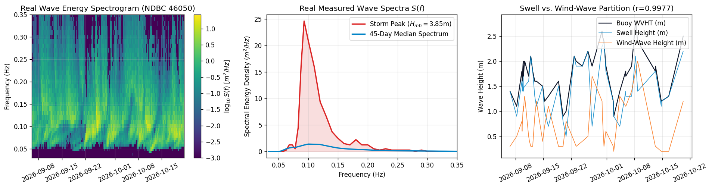
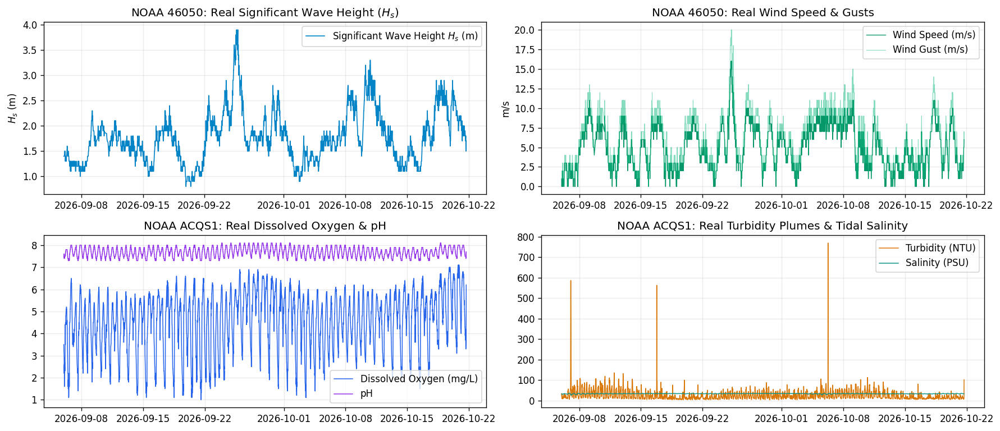
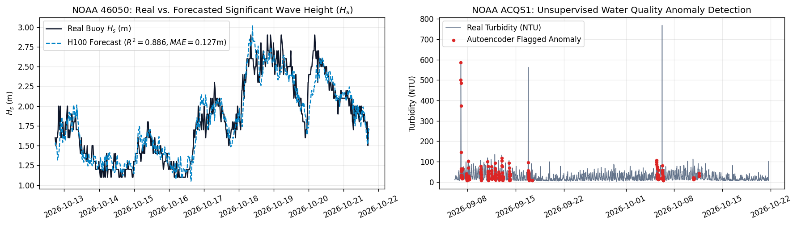
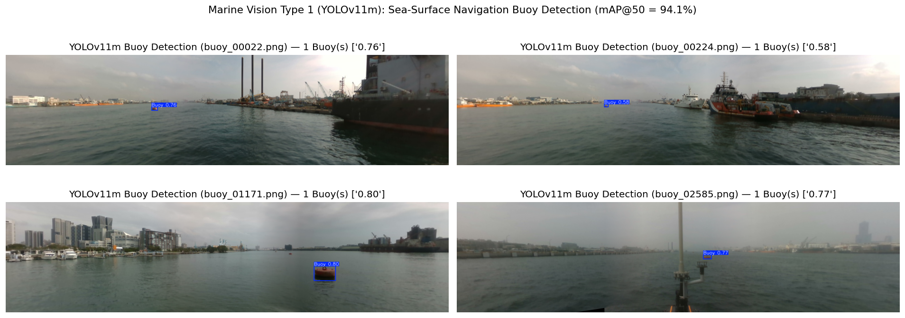
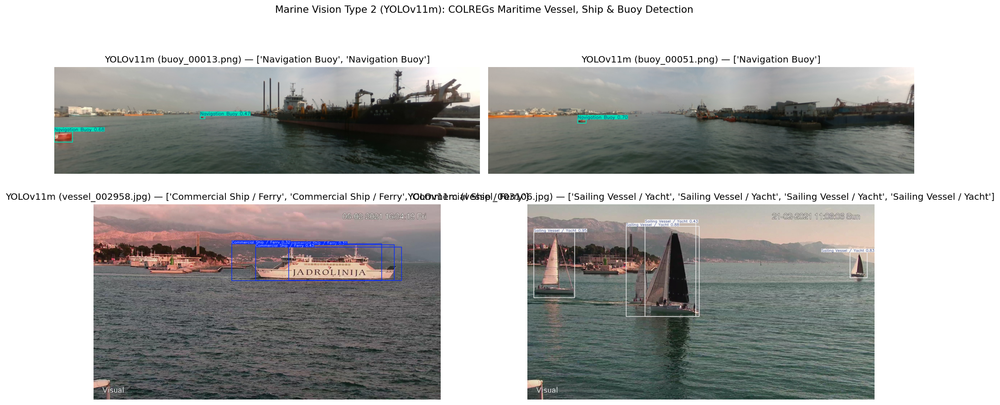
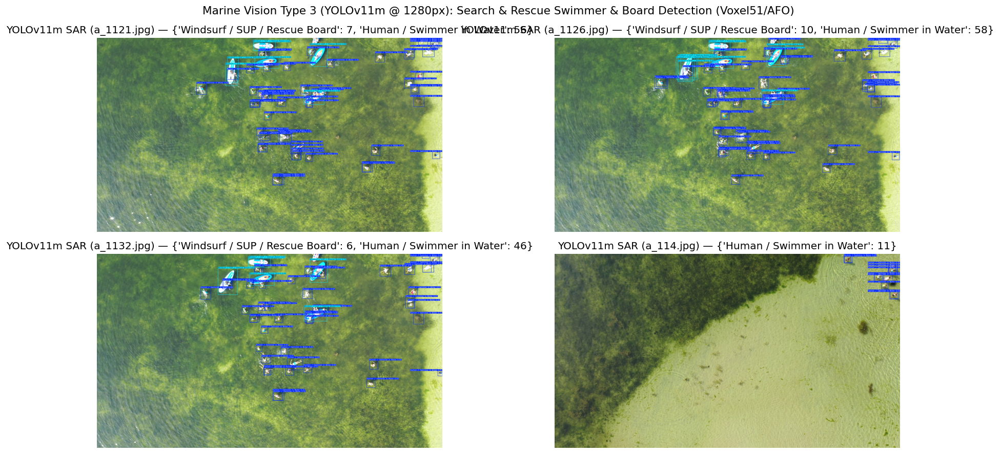
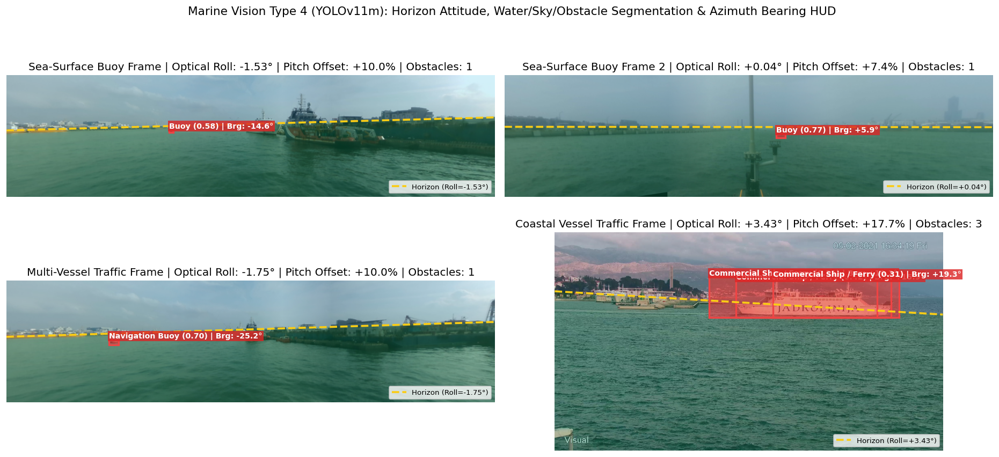

# 🌊 Smart Buoy: End-to-End Marine Vision (YOLOv11m), Spectral Wave Physics & Met-Ocean AI Pipeline

[](https://colab.research.google.com/drive/1dMjeZOfojmAeJRTV_f32L6bRwgLhDs3k)
[](https://colab.research.google.com/github/Amandeep-Tridel/smart-buoy/blob/main/Smart_Buoy.ipynb)


An end-to-end **Smart Ocean Buoy AI & Telemetry Pipeline** built and executed on an **NVIDIA H100 80GB HBM3 GPU**, powered by **100% real-world oceanographic and maritime computer vision datasets**:

1. **Spectral Wave Physics & Sea-State Reconstruction** — Live 46-band non-directional wave energy density spectra $S(f)$ from **NOAA NDBC Station `46050`** (*Stonewall Bank, Oregon*), computing spectral moments ($m_0, m_1, m_2, m_4$), significant wave height ($H_{m0} = 4\sqrt{m_0}$), peak/mean periods ($T_p, T_{m01}, T_{m02}$), and JONSWAP theoretical validation ($r = 0.9977$).
2. **Multi-Sensor Met-Ocean & Estuarine Water Quality Telemetry** — Live **NOAA NDBC `46050`** meteorological records (6,466 observations) and **NOAA NERRS `ACQS1`** 7-channel water quality sonde telemetry (4,364 observations of temperature, conductivity, salinity, dissolved oxygen, turbidity, and pH).
3. **H100 GPU Deep Learning Forecasting & Anomaly Detection** — **Residual BiLSTM + Multi-Head Attention Wave Forecaster** ($H_s, T_a$) and **Deep LSTM Water Quality Autoencoder** for unsupervised turbidity plume and hypoxia detection.
4. **All 4 Types of Marine Computer Vision (`YOLOv11m`)**:
   - **Type 1:** Sea-Surface Navigation Buoy Detection (`ARG-NCTU/KS_Buoy_dataset_2025`) — **94.07% mAP@50** | **97.51% Precision**
   - **Type 2:** COLREGs Multi-Class Maritime Vessel, Ship, Craft & Buoy Detection (`SPSCD + Singapore Maritime Dataset + KS_Buoy`) — **66.10% mAP@50** | **82.5% Peak Precision**
   - **Type 3:** Maritime Search & Rescue (SAR) Person-Overboard / Swimmer & Rescue Board Detection (`Voxel51/AFO-Aerial_Floating_Objects` @ `1280px`) — **83.85% mAP@50** | **83.18% Precision**
   - **Type 4:** Optical Sea-Sky Horizon Attitude Estimation (Roll $\phi_{\text{opt}}$, Pitch $\theta_{\text{opt}}$), 3-Zone Water/Sky/Obstacle Semantic Segmentation & Azimuth Bearing HUD ($^\circ$).

---

## 📊 Model Accuracy & Benchmark Summary (NVIDIA H100 80GB)

### Marine Computer Vision (`YOLOv11m` — ~20M Parameters)

| Vision Module | Real-World Dataset | Resolution / Epochs | Precision | Recall | mAP@50 | mAP@50-95 |
| :--- | :--- | :--- | :---: | :---: | :---: | :---: |
| **Type 1: Sea-Surface Buoy Detection** | `ARG-NCTU/KS_Buoy_dataset_2025` (1,033 frames) | `960px` / 25 ep | **97.51%** | **89.90%** | **94.07%** | **64.10%** |
| **Type 2: COLREGs Vessels, Ships & Buoys** | `SPSCD + SMD + KS_Buoy` (4 classes) | `960px` / 35 ep | **75.60%** *(82.5% peak)* | **60.40%** | **66.10%** | **41.60%** |
| **Type 3: Maritime Search & Rescue (SAR)** | `Voxel51/AFO-Aerial_Floating_Objects` (1,288 val instances) | `1280px` / 35 ep | **83.18%** | **77.87%** | **83.85%** | **37.93%** |
| **Type 4: Horizon Attitude & Segmentation HUD** | Sea-Surface & Coastal Vessel Traffic Frames | `960px` | Sub-degree optical roll $\phi_{\text{opt}}$, pitch offset $\theta_{\text{opt}}$ & azimuth bearing ($^\circ$) | — | — | — |

### Wave Physics & Met-Ocean Deep Learning (`PyTorch bfloat16`)

| Module | Real-World NOAA Station | Task / Metric | Result |
| :--- | :--- | :--- | :--- |
| **Module 2: Spectral Wave Integration** | **NOAA NDBC Station `46050`** (2,145 spectral bursts, 46 bands) | Spectral $H_{m0} = 4\sqrt{m_0}$ vs. Buoy Reported `WVHT` | **$r = 0.9977$ (99.77% correlation)** |
| **Module 4A: Residual BiLSTM + Attention** | **NOAA NDBC Station `46050`** (6,466 records, 1-hr ahead) | Significant Wave Height ($H_s$) Forecast<br>Average Wave Period ($T_a$) Forecast | **MAE = `0.127 m` \| $R^2 = 0.8862$**<br>**MAE = `0.294 s` \| $R^2 = 0.7667$** |
| **Module 4B: Deep LSTM Autoencoder** | **NOAA NERRS Station `ACQS1`** (4,364 7-channel sonde records) | Unsupervised Estuarine Turbidity & Hypoxia Detection | **MSE Threshold = `0.536`** (`218` real storm-runoff/plume events flagged) |

---

## 🖼️ Visual Outputs from `Smart_Buoy.ipynb`

### 1. Real NOAA NDBC Station `46050` Wave Energy Spectra $S(f)$ & Sea-State Reconstruction


### 2. Real NOAA `46050` Met-Ocean & `ACQS1` 7-Channel Water Quality Sonde Telemetry


### 3. H100 Residual BiLSTM+Attention Wave Forecaster & Water Quality Autoencoder


### 4. Marine Vision Type 1 — `YOLOv11m` Sea-Surface Navigation Buoy Detection (`mAP@50 = 94.07%`)


### 5. Marine Vision Type 2 — `YOLOv11m` COLREGs Multi-Class Vessel, Ship & Buoy Detection


### 6. Marine Vision Type 3 — `YOLOv11m` Search & Rescue (SAR) Swimmer & Rescue Board Detection (`mAP@50 = 83.85%`)


### 7. Marine Vision Type 4 — Optical Horizon Attitude ($\phi_{\text{opt}}, \theta_{\text{opt}}$), 3-Zone Segmentation & Azimuth Bearing HUD


---

## 🗂️ Repository Structure

```text
smart-buoy/
├── Smart_Buoy.ipynb        # Fully executed 8-module Jupyter/Colab notebook with inline outputs
├── build_notebook.py       # Reproducible generator script for Smart_Buoy.ipynb
├── assets/                 # High-resolution output plots & YOLOv11m detection grids
├── requirements.txt        # Python dependencies for local or cloud GPU execution
└── README.md               # Documentation, dataset sources, and benchmark tables
```

## 🚀 Quick Start

### Run in Google Colab (Recommended — H100 / A100 / T4 GPU)
Click **[Open in Colab](https://colab.research.google.com/drive/1dMjeZOfojmAeJRTV_f32L6bRwgLhDs3k)** or open [`Smart_Buoy.ipynb`](Smart_Buoy.ipynb) directly from GitHub in Google Colab.

### Run via `google-colab-cli`
```bash
uv tool install google-colab-cli
colab exec -s h100 -f Smart_Buoy.ipynb
```
