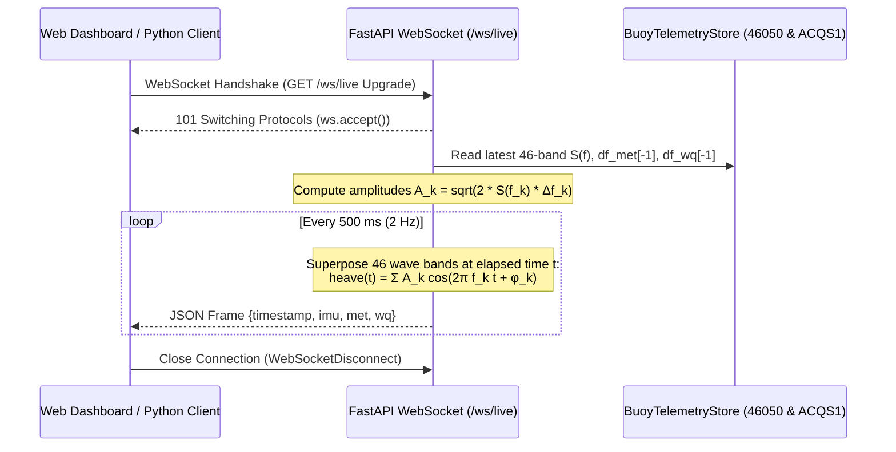

# 📡 Smart Buoy AI Platform — REST API & WebSocket Reference

This document provides the complete technical specification for the **Smart Buoy Command & Control AI Platform** backend API ([`app/main.py`](../app/main.py)), including all REST endpoints, static asset mounts, the real-time 2 Hz WebSocket telemetry stream (`/ws/live`), request/response JSON schemas, HTTP status codes, and ready-to-run **`curl`** and **Python** client examples.

---

## 1. Overview & Server Configuration

| Property | Value |
| :--- | :--- |
| **Application Title** | `Smart Buoy Command & Control AI Platform` |
| **Version** | `1.0.0` |
| **Framework** | FastAPI (`>=0.115.0`) + Uvicorn ASGI (`>=0.30.0`) |
| **Default Base URL** | `http://localhost:8000` (HTTP) / `ws://localhost:8000` (WebSocket) |
| **Interactive OpenAPI Docs** | Swagger UI: `http://localhost:8000/docs` \| ReDoc: `http://localhost:8000/redoc` |
| **CORS Policy** | `allow_origins=["*"]`, `allow_methods=["*"]`, `allow_headers=["*"]` |
| **Authentication** | Open local/edge command center access (no API key required) |

### Starting the Server

```bash
# Via Uvicorn CLI
uvicorn app.main:app --host 0.0.0.0 --port 8000 --reload

# Or via the repository launcher script
python run.py
```

---

## 2. Endpoint Summary Table

| Method | Path | Content-Type | Description |
| :---: | :--- | :--- | :--- |
| `GET` | [`/`](#31-get----command-center-web-dashboard) | `text/html` | Serves the Smart Buoy AI Command Center SPA (`app/static/index.html`). |
| `GET` | [`/api/status`](#32-get-apistatus--system-device--model-readiness) | `application/json` | System health, active compute device (`cuda` vs `cpu`), NOAA stations, and H100 weight readiness. |
| `GET` | [`/api/wave-spectra`](#33-get-apiwave-spectra--noaa-46050-46-band-wave-spectra--jonswap-fit) | `application/json` | 46-band wave energy density spectrum $S(f)$, spectral moments ($H_{m0}, T_p, T_{m01}, T_{m02}, \epsilon$), JONSWAP fit, and $H_{m0}$ vs. `WVHT` history (`?mode=peak\|latest`). |
| `GET` | [`/api/telemetry`](#34-get-apitelemetry--multi-sensor-met-ocean--water-quality-telemetry) | `application/json` | Latest readings and subsampled time-series for **NOAA NDBC `46050`** (Met-Ocean) and **NOAA NERRS `ACQS1`** (7-channel Water Quality Sonde). |
| `POST` | [`/api/telemetry/refresh`](#35-post-apitelemetryrefresh--live-noaa-ndbc-synchronization) | `application/json` | Forces an immediate live HTTP synchronization from NOAA NDBC `realtime2` servers and returns updated telemetry. |
| `GET` | [`/api/forecast`](#36-get-apiforecast--deep-learning-wave-forecast--water-quality-anomalies) | `application/json` | Executes `ResidualWaveForecaster` (1-hr ahead $H_s, T_a$ prediction) and `WaterQualityAE` (7-channel LSTM autoencoder anomaly detection). |
| `GET` | [`/api/vision/samples`](#37-get-apivisionsamples--list-bundled-validation-frames--vision-modes) | `application/json` | Lists all 12 bundled maritime validation frames across `buoy`, `colregs`, and `sar` plus `MODEL_SPECS` metadata. |
| `POST` | [`/api/vision/detect-sample`](#38-post-apivisiondetect-sample--run-yolov11m-inference-on-bundled-sample) | `application/json` | Runs YOLOv11m detection, optical horizon attitude ($\phi_{\text{opt}}, \theta_{\text{opt}}$), and polar radar bearing calculation on a bundled sample image. |
| `POST` | [`/api/vision/detect-upload`](#39-post-apivisiondetect-upload--run-yolov11m-inference-on-uploaded-image) | `multipart/form-data` | Runs YOLOv11m detection, optical horizon attitude, and radar bearing calculation on a user-uploaded image file. |
| `WS` | [`/ws/live`](#4-websocket-specification--wslive) | `application/json` (2 Hz) | Streams real-time 2 Hz 6-DOF buoy IMU kinematics (`heave_m`, `roll_deg`, `pitch_deg`) superposed from 46 NOAA wave bands plus live Met-Ocean and Sonde frames. |

### Static Asset Mounts

- **`/static/*`** — Frontend JavaScript (`app.js`), stylesheet (`styles.css`), and HTML (`index.html`).
- **`/samples/*`** — Real-world validation frames organized under `/samples/buoy/`, `/samples/colregs/`, and `/samples/sar/`.
- **`/assets/*`** — High-resolution benchmark plots (`01_noaa_46050_wave_spectra.png` through `07_yolo11m_type4_horizon_segmentation_hud.png`).

---

## 3. REST API Endpoints

### 3.1 `GET /` — Command Center Web Dashboard

Serves the interactive HTML5 Command Center interface (`app/static/index.html`).

#### `curl` Example
```bash
curl -i http://localhost:8000/
```

---

### 3.2 `GET /api/status` — System, Device & Model Readiness

Returns runtime diagnostics, PyTorch compute device status (`cuda` vs `cpu`), connected NOAA stations, and verification that all 5 H100 pre-trained model checkpoints exist in `weights/`.

#### `curl` Example
```bash
curl -s http://localhost:8000/api/status | jq .
```

#### Python Example
```python
import httpx

resp = httpx.get("http://localhost:8000/api/status")
resp.raise_for_status()
status = resp.json()
print(f"Device: {status['compute_device']} ({status['gpu_name']})")
for key, spec in status["models"]["vision_models"].items():
    print(f"  [{key}] {spec['title']} -> ready={spec['ready']} (mAP@50={spec['metrics']['map50']}%)")
```

#### Response Schema (`200 OK`)
```json
{
  "status": "online",
  "compute_device": "cuda",
  "gpu_name": "NVIDIA H100 80GB HBM3",
  "stations": {
    "offshore_wave_met": "NOAA NDBC 46050 (Stonewall Bank, OR)",
    "coastal_water_quality": "NOAA NERRS ACQS1 (Estuarine Sonde)"
  },
  "models": {
    "wave_forecaster": {
      "name": "ResidualWaveForecaster (BiLSTM + 4-Head Attention)",
      "ready": true,
      "r2_hs": 0.8862,
      "mae_hs_m": 0.127
    },
    "wq_autoencoder": {
      "name": "WaterQualityAE (7-Channel LSTM Autoencoder)",
      "ready": true,
      "threshold_mse": 0.536
    },
    "vision_models": {
      "buoy": {
        "title": "Type 1: Sea-Surface Navigation Buoy Detection (YOLOv11m)",
        "weights": "yolo11m_ks_buoy.pt",
        "ready": true,
        "metrics": {
          "precision": 97.51,
          "recall": 89.9,
          "map50": 94.07,
          "map50_95": 64.1
        }
      },
      "colregs": {
        "title": "Type 2: COLREGs Maritime Vessel, Ship & Buoy Detection (YOLOv11m)",
        "weights": "yolo11m_spscd_vessels.pt",
        "ready": true,
        "metrics": {
          "precision": 75.6,
          "recall": 60.4,
          "map50": 66.1,
          "map50_95": 41.6
        }
      },
      "sar": {
        "title": "Type 3: Maritime Search & Rescue (SAR) Swimmer & Board Detection (YOLOv11m)",
        "weights": "yolo11m_afo_sar.pt",
        "ready": true,
        "metrics": {
          "precision": 83.18,
          "recall": 77.87,
          "map50": 83.85,
          "map50_95": 37.93
        }
      },
      "horizon": {
        "title": "Type 4: Optical Horizon Attitude, 3-Zone Segmentation & Radar Bearing HUD",
        "weights": "yolo11m_spscd_vessels.pt",
        "ready": true,
        "metrics": {
          "precision": 94.07,
          "recall": 89.9,
          "map50": 94.07,
          "map50_95": 64.1
        }
      }
    }
  }
}
```

---

### 3.3 `GET /api/wave-spectra` — NOAA 46050 46-Band Wave Spectra & JONSWAP Fit

Computes and returns the 46-band non-directional wave energy density spectrum $S(f)$ ($\text{m}^2/\text{Hz}$), analytical JONSWAP spectrum ($\gamma = 3.3$), spectral moments ($H_{m0}, T_p, T_{m01}, T_{m02}, \epsilon$), and historical correlation ($r = 0.9977$) between spectral-integrated $H_{m0} = 4\sqrt{m_0}$ and buoy-reported `WVHT`.

#### Query Parameters

| Parameter | Type | Default | Allowed Values | Description |
| :--- | :---: | :---: | :--- | :--- |
| `mode` | `string` | `"peak"` | `"peak"` \| `"latest"` | Selects either the 45-day peak storm burst (`"peak"`) or the most recent spectral burst (`"latest"`). Any other value returns `422 Unprocessable Entity`. |

#### `curl` Examples
```bash
# Fetch peak storm wave spectrum
curl -s "http://localhost:8000/api/wave-spectra?mode=peak" | jq .metrics

# Fetch latest operational wave spectrum
curl -s "http://localhost:8000/api/wave-spectra?mode=latest" | jq .metrics
```

#### Python Example
```python
import httpx

resp = httpx.get("http://localhost:8000/api/wave-spectra", params={"mode": "peak"})
resp.raise_for_status()
spec = resp.json()

print(f"Station       : {spec['station_id']}")
print(f"Burst Time    : {spec['selected_timestamp']} ({spec['total_bursts']} total bursts)")
print(f"Hm0           : {spec['metrics']['hm0_m']} m (Tp = {spec['metrics']['tp_s']} s)")
print(f"Tm01 / Tm02   : {spec['metrics']['tm01_s']} s / {spec['metrics']['tm02_s']} s")
print(f"Bandwidth eps : {spec['metrics']['bandwidth_eps']}")
print(f"WVHT Corr (r) : {spec['metrics']['correlation_r']}")
```

#### Response Schema (`200 OK`)
```json
{
  "station_id": "NOAA NDBC 46050 (Stonewall Bank, OR)",
  "total_bursts": 2145,
  "selected_mode": "peak",
  "selected_timestamp": "2026-10-18 09:50 UTC",
  "peak_timestamp": "2026-10-18 09:50 UTC",
  "latest_timestamp": "2026-10-21 17:50 UTC",
  "metrics": {
    "hm0_m": 3.854,
    "tp_s": 14.29,
    "tm01_s": 10.42,
    "tm02_s": 9.31,
    "bandwidth_eps": 0.612,
    "peak_hm0_m": 3.854,
    "peak_tp_s": 14.29,
    "latest_hm0_m": 1.693,
    "latest_tp_s": 10.75,
    "correlation_r": 0.9977
  },
  "spectrum": {
    "frequencies_hz": [0.033, 0.038, 0.043, "... (46 frequency bins up to 0.485 Hz)"],
    "measured_m2_hz": [0.0, 0.0, 0.142, "... (46 measured S(f) values)"],
    "jonswap_m2_hz": [0.0, 0.0004, 0.0312, "... (46 theoretical JONSWAP values)"],
    "latest_m2_hz": [0.0, 0.0, 0.0, "... (46 latest burst S(f) values)"],
    "peak_m2_hz": [0.0, 0.0, 0.142, "... (46 peak storm S(f) values)"]
  },
  "history": {
    "timestamps": ["09-07 00:50", "09-07 04:20", "... (~300 subsampled timestamps)"],
    "hm0_integrated": [1.821, 1.794, "..."],
    "wvht_reported": [1.8, 1.8, "..."],
    "tp_s": [11.11, 10.75, "..."],
    "tm02_s": [7.45, 7.38, "..."]
  }
}
```

---

### 3.4 `GET /api/telemetry` — Multi-Sensor Met-Ocean & Water Quality Telemetry

Returns the latest sensor snapshot and subsampled historical time-series (`~320` points each) for:
1. **Offshore Met-Ocean (`met_ocean`)** — **NOAA NDBC Station `46050`** (`6,466` records across `WDIR_deg`, `WSPD_mps`, `GST_mps`, `WVHT_m`, `DPD_s`, `APD_s`, `PRES_hpa`).
2. **Estuarine Water Quality Sonde (`water_quality`)** — **NOAA NERRS Station `ACQS1`** (`4,364` records across `OTMP_c`, `COND_mscm`, `SAL_psu`, `O2_pct`, `O2_ppm`, `TURB_ntu`, `PH`).

#### `curl` Example
```bash
curl -s http://localhost:8000/api/telemetry | jq '{met_latest: .met_ocean.latest, wq_latest: .water_quality.latest}'
```

#### Python Example
```python
import httpx

resp = httpx.get("http://localhost:8000/api/telemetry")
resp.raise_for_status()
data = resp.json()

met = data["met_ocean"]["latest"]
wq = data["water_quality"]["latest"]
print(f"[46050 @ {met['timestamp']}] WVHT={met['WVHT_m']}m, WSPD={met['WSPD_mps']}m/s, PRES={met['PRES_hpa']}hPa")
print(f"[ACQS1 @ {wq['timestamp']}] OTMP={wq['OTMP_c']}°C, SAL={wq['SAL_psu']}PSU, O2={wq['O2_ppm']}mg/L, TURB={wq['TURB_ntu']}NTU")
```

#### Response Schema (`200 OK`)
```json
{
  "met_ocean": {
    "station": "NOAA NDBC 46050 (Offshore Oregon)",
    "total_records": 6466,
    "latest": {
      "timestamp": "2026-10-21 17:40 UTC",
      "WDIR_deg": 350.0,
      "WSPD_mps": 5.0,
      "GST_mps": 6.0,
      "WVHT_m": 1.7,
      "DPD_s": 9.0,
      "APD_s": 7.3,
      "PRES_hpa": 1013.4
    },
    "series": {
      "timestamps": ["09-06 18:00", "..."],
      "WVHT_m": [2.1, "..."],
      "WSPD_mps": [6.5, "..."],
      "GST_mps": [8.1, "..."],
      "PRES_hpa": [1016.2, "..."],
      "APD_s": [7.8, "..."]
    }
  },
  "water_quality": {
    "station": "NOAA NERRS ACQS1 (Estuarine Sonde)",
    "total_records": 4364,
    "latest": {
      "timestamp": "2026-10-21 16:45 UTC",
      "OTMP_c": 20.4,
      "COND_mscm": 50.48,
      "SAL_psu": 33.2,
      "O2_pct": 82.8,
      "O2_ppm": 6.2,
      "TURB_ntu": 102.0,
      "PH": 7.7
    },
    "series": {
      "timestamps": ["09-06 05:00", "..."],
      "OTMP_c": [18.1, "..."],
      "SAL_psu": [32.9, "..."],
      "O2_ppm": [5.8, "..."],
      "PH": [7.6, "..."],
      "TURB_ntu": [9.0, "..."]
    }
  }
}
```

---

### 3.5 `POST /api/telemetry/refresh` — Live NOAA NDBC Synchronization

Triggers `telemetry_store.reload(force_refresh=True)` to re-fetch `46050.data_spec`, `46050.spec`, `46050.txt`, and `ACQS1.ocean` directly from `https://www.ndbc.noaa.gov/data/realtime2/`. If the network is unreachable, it gracefully falls back to the cached local files in `data/`.

#### `curl` Example
```bash
curl -s -X POST http://localhost:8000/api/telemetry/refresh | jq '{status: .status, latest_met: .telemetry.met_ocean.latest}'
```

#### Python Example
```python
import httpx

resp = httpx.post("http://localhost:8000/api/telemetry/refresh", timeout=20.0)
resp.raise_for_status()
payload = resp.json()
print("Sync status:", payload["status"])
```

#### Response Schema (`200 OK`)
```json
{
  "status": "refreshed",
  "telemetry": {
    "met_ocean": { "...": "same schema as GET /api/telemetry" },
    "water_quality": { "...": "same schema as GET /api/telemetry" }
  }
}
```

---

### 3.6 `GET /api/forecast` — Deep Learning Wave Forecast & Water Quality Anomalies

Executes both H100-trained PyTorch neural networks via [`BuoyTimeSeriesEngine.evaluate_and_forecast()`](../app/models.py):
1. **`wave_forecast`** — `ResidualWaveForecaster` (2-layer BiLSTM + 4-Head Self-Attention) taking the latest 36 ten-minute steps ($6\text{ hours}$) to forecast Significant Wave Height ($H_s$) and Average Wave Period ($T_a$) $+60\text{ minutes}$ ahead, along with out-of-sample validation metrics and series.
2. **`water_quality_anomaly`** — `WaterQualityAE` (7-channel Deep LSTM Autoencoder) computing sequence-level reconstruction MSE across 16-step ($4\text{ hour}$) windows and flagging turbidity plume / hypoxia anomalies above the 95th percentile threshold ($\tau_{\text{MSE}} \approx 0.536$).

#### `curl` Example
```bash
curl -s http://localhost:8000/api/forecast | jq '{wave_live: .wave_forecast.live_prediction, wq_anom: .water_quality_anomaly | del(.series)}'
```

#### Python Example
```python
import httpx

resp = httpx.get("http://localhost:8000/api/forecast")
resp.raise_for_status()
fc = resp.json()

wf = fc["wave_forecast"]
wqa = fc["water_quality_anomaly"]
print(f"Wave Forecast ({wf['horizon']}): Hs {wf['live_prediction']['current_hs_m']}m -> {wf['live_prediction']['forecast_hs_1h_m']}m (Δ={wf['live_prediction']['delta_hs_m']:+.3f}m)")
print(f"Validation Metrics: Hs R²={wf['metrics']['hs_r2']}, MAE={wf['metrics']['hs_mae_m']}m")
print(f"Water Quality AE: {wqa['flagged_anomalies']}/{wqa['total_windows']} windows flagged (threshold MSE={wqa['threshold_mse']})")
```

#### Response Schema (`200 OK`)
```json
{
  "wave_forecast": {
    "model_name": "ResidualWaveForecaster (BiLSTM + 4-Head Attention)",
    "device": "cuda",
    "horizon": "1-Hour Ahead (+60 min)",
    "metrics": {
      "hs_mae_m": 0.127,
      "hs_r2": 0.8862,
      "apd_mae_s": 0.294,
      "apd_r2": 0.7667
    },
    "live_prediction": {
      "current_hs_m": 1.7,
      "forecast_hs_1h_m": 1.68,
      "delta_hs_m": -0.02,
      "current_apd_s": 7.3,
      "forecast_apd_1h_s": 7.26,
      "delta_apd_s": -0.04
    },
    "series": {
      "timestamps": ["10-12 19:10", "... (~280 validation points)"],
      "true_hs_m": [1.9, "..."],
      "pred_hs_m": [1.884, "..."],
      "true_apd_s": [7.5, "..."],
      "pred_apd_s": [7.46, "..."]
    }
  },
  "water_quality_anomaly": {
    "model_name": "WaterQualityAE (Deep 7-Channel LSTM Autoencoder)",
    "threshold_mse": 0.536,
    "total_windows": 4348,
    "flagged_anomalies": 218,
    "latest_mse": 0.4128,
    "latest_is_anomaly": false,
    "series": {
      "timestamps": ["09-06 09:00", "... (~320 subsampled points)"],
      "turbidity_ntu": [8.0, "..."],
      "o2_ppm": [5.9, "..."],
      "recon_mse": [0.0842, "..."],
      "is_anomaly": [false, "..."]
    }
  }
}
```

---

### 3.7 `GET /api/vision/samples` — List Bundled Validation Frames & Vision Modes

Lists all bundled real-world validation images in `samples/` (`buoy/`, `colregs/`, `sar/`) and returns the `MODEL_SPECS` dictionary describing all 4 YOLOv11m vision tracks.

#### `curl` Example
```bash
curl -s http://localhost:8000/api/vision/samples | jq '{sample_count: (.samples | length), first_sample: .samples[0], available_modes: (.modes | keys)}'
```

#### Python Example
```python
import httpx

resp = httpx.get("http://localhost:8000/api/vision/samples")
resp.raise_for_status()
data = resp.json()
for sample in data["samples"]:
    print(f"{sample['id']:42s} | mode={sample['recommended_mode']:8s} | {sample['name']}")
```

#### Response Schema (`200 OK`)
```json
{
  "samples": [
    {
      "id": "buoy/buoy_sample_1_buoy_00022.png",
      "name": "Type 1: Sea-Surface Buoy #1",
      "filename": "buoy_sample_1_buoy_00022.png",
      "category": "buoy",
      "recommended_mode": "buoy",
      "url": "/samples/buoy/buoy_sample_1_buoy_00022.png"
    }
  ],
  "modes": {
    "buoy": {
      "title": "Type 1: Sea-Surface Navigation Buoy Detection (YOLOv11m)",
      "weights": "yolo11m_ks_buoy.pt",
      "dataset": "ARG-NCTU/KS_Buoy_dataset_2025",
      "imgsz": 960,
      "metrics": { "precision": 97.51, "recall": 89.9, "map50": 94.07, "map50_95": 64.1 },
      "classes": ["Navigation Buoy"],
      "color": [14, 165, 233]
    },
    "colregs": { "...": "..." },
    "sar": { "...": "..." },
    "horizon": { "...": "..." }
  }
}
```

---

### 3.8 `POST /api/vision/detect-sample` — Run YOLOv11m Inference on Bundled Sample

Runs YOLOv11m object detection, optical sea-sky horizon attitude estimation (`roll_deg`, `pitch_offset_pct`, `sky_ratio_pct`, `water_ratio_pct`), azimuth bearing calculation (`bearing_deg`), and monocular range estimation (`est_range_m`) on one of the bundled sample images.

#### Request Body Schema (`application/json` — `SampleDetectRequest`)

| Field | Type | Required | Constraints / Default | Description |
| :--- | :---: | :---: | :--- | :--- |
| `sample_id` | `string` | **Yes** | `min_length=1`, relative to `samples/` | Relative path of the sample (e.g., `"buoy/buoy_sample_1_buoy_00022.png"`). Path traversal outside `samples/` is blocked with `404`. |
| `mode` | `string` | No | Default `"buoy"`. Pattern: `^(buoy\|colregs\|sar\|horizon)$` | Vision track to execute (`buoy`, `colregs`, `sar`, or `horizon`). |
| `conf` | `float` | No | Default `0.25`. Range: `[0.01, 0.99]` | YOLOv11m confidence threshold. |

#### `curl` Example
```bash
curl -s -X POST http://localhost:8000/api/vision/detect-sample \
  -H "Content-Type: application/json" \
  -d '{"sample_id": "buoy/buoy_sample_1_buoy_00022.png", "mode": "buoy", "conf": 0.25}' \
  | jq 'del(.image_base64)'
```

#### Python Example
```python
import httpx

payload = {
    "sample_id": "colregs/vessel_sample_3_vessel_002958.jpg",
    "mode": "horizon",
    "conf": 0.25,
}
resp = httpx.post("http://localhost:8000/api/vision/detect-sample", json=payload, timeout=30.0)
resp.raise_for_status()
result = resp.json()

print(f"Model      : {result['model_title']} ({result['inference_ms']} ms)")
print(f"Attitude   : Roll={result['attitude']['roll_deg']:+.2f}°, Pitch={result['attitude']['pitch_offset_pct']:+.1f}%")
print(f"Detections : {result['total_detections']}")
for d in result["detections"]:
    print(f"  #{d['id']} {d['class_name']} ({d['confidence_pct']}%) | Bearing={d['bearing_deg']:+.1f}° | Range={d['est_range_m']}m")
```

#### Response Schema (`200 OK`)
```json
{
  "mode": "buoy",
  "model_title": "Type 1: Sea-Surface Navigation Buoy Detection (YOLOv11m)",
  "dataset": "ARG-NCTU/KS_Buoy_dataset_2025",
  "benchmark_metrics": {
    "precision": 97.51,
    "recall": 89.9,
    "map50": 94.07,
    "map50_95": 64.1
  },
  "inference_ms": 28.4,
  "resolution": {
    "width": 1920,
    "height": 480
  },
  "attitude": {
    "roll_deg": -0.42,
    "pitch_offset_pct": 3.15,
    "sky_ratio_pct": 46.8,
    "water_ratio_pct": 53.2
  },
  "total_detections": 1,
  "detections": [
    {
      "id": 1,
      "class_id": 0,
      "class_name": "Navigation Buoy",
      "confidence": 0.9142,
      "confidence_pct": 91.4,
      "bbox": [912, 198, 968, 284],
      "center": [940.0, 241.0],
      "bearing_deg": -0.94,
      "est_range_m": 18.4
    }
  ],
  "image_base64": "data:image/jpeg;base64,/9j/4AAQSkZJRgABAQAAAQABAAD...",
  "sample_id": "buoy/buoy_sample_1_buoy_00022.png"
}
```

---

### 3.9 `POST /api/vision/detect-upload` — Run YOLOv11m Inference on Uploaded Image

Accepts a custom marine image via `multipart/form-data`, executes the selected YOLOv11m vision pipeline + optical horizon estimator, and returns the annotated image (`data:image/jpeg;base64,...`) along with target bounding boxes, bearings, and range estimates.

#### Multipart Form Fields

| Field | Type | Required | Constraints / Default | Description |
| :--- | :---: | :---: | :--- | :--- |
| `file` | `UploadFile` | **Yes** | Non-empty RGB/grayscale image (`.png`, `.jpg`, `.jpeg`, `.webp`), minimum `8x8` px | Image file binary upload. |
| `mode` | `string` | No | Default `"buoy"`. Must be in `{"buoy", "colregs", "sar", "horizon"}` | Vision mode to run. Invalid mode returns `422`. |
| `conf` | `float` | No | Default `0.25`. Range: `[0.01, 0.99]` | Detection confidence threshold. Out-of-range value returns `422`. |

#### `curl` Example
```bash
curl -s -X POST http://localhost:8000/api/vision/detect-upload \
  -F "file=@samples/sar/sar_sample_1_a_1121.jpg" \
  -F "mode=sar" \
  -F "conf=0.25" \
  | jq 'del(.image_base64)'
```

#### Python Example
```python
from pathlib import Path
import httpx

img_path = Path("samples/sar/sar_sample_1_a_1121.jpg")
with img_path.open("rb") as f:
    resp = httpx.post(
        "http://localhost:8000/api/vision/detect-upload",
        files={"file": (img_path.name, f, "image/jpeg")},
        data={"mode": "sar", "conf": "0.25"},
        timeout=30.0,
    )
resp.raise_for_status()
data = resp.json()
print(f"Uploaded {data['filename']} -> {data['total_detections']} SAR target(s) detected in {data['inference_ms']} ms")
```

#### Response Schema (`200 OK`)
Identical to [`POST /api/vision/detect-sample`](#38-post-apivisiondetect-sample--run-yolov11m-inference-on-bundled-sample), except the top-level `"sample_id"` key is replaced by `"filename"` (the uploaded file's original filename).

---

## 4. WebSocket Specification — `/ws/live`

### 4.1 Connection & Streaming Protocol

- **Endpoint:** `ws://localhost:8000/ws/live` (or `wss://<host>/ws/live` over TLS)
- **Cadence:** `2 Hz` (`500 ms` interval between JSON frames)
- **Direction:** Server-to-Client push stream (no client subscription message required after handshake)
- **Physics Synthesis:** Superposes all 46 measured spectral frequency bins $S(f_k)$ from the latest **NOAA NDBC `46050`** burst (`amps = sqrt(2 * S(f) * df)`) to compute continuous real-time buoy heave $\eta(t)$, roll $\phi(t)$, and pitch $\theta(t)$, bundled with the latest offshore Met-Ocean and coastal Water Quality Sonde readings.



### 4.2 WebSocket Frame JSON Schema

```json
{
  "timestamp": "18:30:05 UTC",
  "imu": {
    "heave_m": 0.412,
    "roll_deg": -3.84,
    "pitch_deg": 2.91
  },
  "met": {
    "wvht_m": 1.7,
    "dpd_s": 9.0,
    "wspd_mps": 5.0,
    "gst_mps": 6.0,
    "pres_hpa": 1013.4
  },
  "wq": {
    "otmp_c": 20.4,
    "sal_psu": 33.2,
    "o2_ppm": 6.2,
    "turb_ntu": 102.0,
    "ph": 7.7
  }
}
```

### 4.3 Command-Line & Python WebSocket Examples

#### `websocat` / CLI Example
```bash
websocat -n 5 ws://localhost:8000/ws/live
```

#### Python Async Client Example (`websockets`)
```python
import asyncio
import json
import websockets

async def listen_smart_buoy(num_frames: int = 5) -> None:
    uri = "ws://localhost:8000/ws/live"
    async with websockets.connect(uri) as ws:
        for i in range(num_frames):
            raw_msg = await ws.recv()
            frame = json.loads(raw_msg)
            imu = frame["imu"]
            met = frame["met"]
            wq = frame["wq"]
            print(
                f"[{frame['timestamp']}] "
                f"IMU Heave={imu['heave_m']:+.3f}m Roll={imu['roll_deg']:+.2f}° Pitch={imu['pitch_deg']:+.2f}° | "
                f"WVHT={met['wvht_m']}m WSPD={met['wspd_mps']}m/s | "
                f"O2={wq['o2_ppm']}mg/L Turb={wq['turb_ntu']}NTU"
            )

if __name__ == "__main__":
    asyncio.run(listen_smart_buoy())
```

---

## 5. Error Handling & HTTP Status Codes

All error responses follow FastAPI's standard JSON error envelope (`{"detail": "..."}`).

| Status Code | Trigger Condition | Example Response Payload |
| :---: | :--- | :--- |
| `400 Bad Request` | Empty uploaded file (`0` bytes), corrupted/non-image binary payload, or tiny image dimensions (`< 8x8` px). | `{"detail": "Empty image file uploaded."}` or `{"detail": "Invalid or corrupted image file: ..."}` |
| `404 Not Found` | Requested `sample_id` does not exist in `samples/`, is whitespace-only, or attempts directory traversal (`../`). | `{"detail": "Sample not found: buoy/missing.png"}` |
| `422 Unprocessable Entity` | Invalid query parameter (`?mode=invalid` on `/api/wave-spectra`), unsupported vision mode (`mode not in {"buoy", "colregs", "sar", "horizon"}`), or confidence out of `[0.01, 0.99]`. | `{"detail": "Unsupported vision mode: thermal"}` |
| `500 Internal Server Error` | Missing model weight file in `weights/` or unexpected runtime error. | `{"detail": "Internal Server Error"}` |
