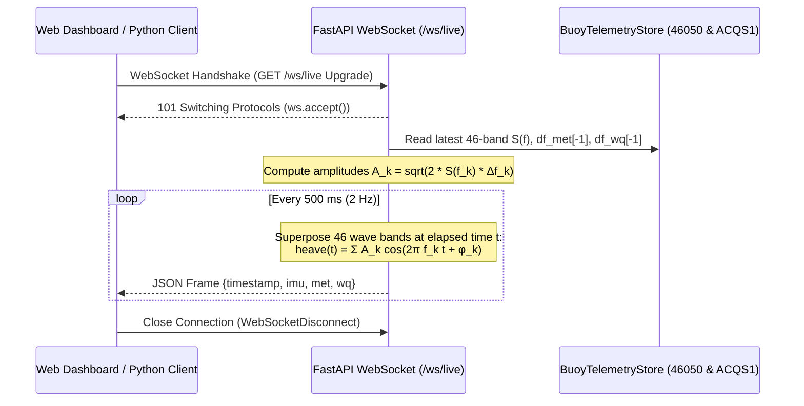

# 📡 Smart Buoy AI Platform — REST API & WebSocket Reference

This document provides the complete technical specification for the **Smart Buoy Command & Control AI Platform** backend API ([`app/main.py`](../app/main.py)), including all REST endpoints, static asset mounts, the real-time 2 Hz WebSocket telemetry stream (`/ws/live`), exact request/response JSON schemas, HTTP status codes, and ready-to-run **`curl`** and **Python** client examples.

---

## 1. Overview & Server Configuration

| Property | Value |
| :--- | :--- |
| **Application Title** | `Smart Buoy Command & Control AI Platform` |
| **Version** | `1.0.0` |
| **Framework** | FastAPI (`>=0.115.0`) + Uvicorn ASGI (`>=0.30.0`) |
| **Default Base URL** | `http://localhost:8000` (HTTP) / `ws://localhost:8000` (WebSocket) |
| **Interactive OpenAPI Docs** | Swagger UI: `http://localhost:8000/docs` \| ReDoc: `http://localhost:8000/redoc` |
| **CORS Policy** | `allow_origins=["*"]`, `allow_methods=["*"]`, `allow_headers=["*"]` |
| **Authentication** | Open local/edge command center access (no API key required) |

### Starting the Server

```bash
# Via Uvicorn CLI
uvicorn app.main:app --host 0.0.0.0 --port 8000 --reload

# Or via the repository launcher script
python run.py

# Or via Docker Compose
docker compose up --build
```

---

## 2. Endpoint Summary Table

| Method | Path | Content-Type | Description |
| :---: | :--- | :--- | :--- |
| `GET` | [`/`](#31-get----command-center-web-dashboard) | `text/html` | Serves the Smart Buoy AI Command Center SPA (`app/static/index.html`). |
| `GET` | [`/api/status`](#32-get-apistatus--system-device--model-readiness) | `application/json` | System health, active compute device (`cuda` vs `cpu`), NOAA stations, and H100 weight readiness. |
| `GET` | [`/api/wave-spectra`](#33-get-apiwave-spectra--noaa-46050-46-band-wave-spectra--jonswap-fit) | `application/json` | 46-band wave energy density spectrum $S(f)$, spectral moments ($H_{m0}, T_p, T_{m01}, T_{m02}, \epsilon$), WMO sea state, wave steepness, Tayfun/BFI rogue wave risk, PM vs. JONSWAP $\gamma$-fit, and $H_{m0}$ vs. `WVHT` history (`?mode=peak\|latest`). |
| `GET` | [`/api/telemetry`](#34-get-apitelemetry--multi-sensor-met-ocean--water-quality-telemetry) | `application/json` | Latest readings, WMO/Beaufort/steepness/rogue-wave classifications, and subsampled time-series for **NOAA NDBC `46050`** (Met-Ocean) and **NOAA NERRS `ACQS1`** (7-channel Water Quality Sonde). |
| `POST` | [`/api/telemetry/refresh`](#35-post-apitelemetryrefresh--live-noaa-ndbc-synchronization) | `application/json` | Forces an immediate live HTTP synchronization from NOAA NDBC `realtime2` servers and returns updated telemetry. |
| `GET` | [`/api/forecast`](#36-get-apiforecast--deep-learning-wave-forecast-water-quality-anomalies--maritime-alerts) | `application/json` | Executes `ResidualWaveForecaster` ($+1\text{h}$ to $+6\text{h}$ multi-step rollout with MC Dropout uncertainty), `WaterQualityAE` (7-channel LSTM autoencoder with per-channel MSE attribution), and `MaritimeAlertEngine` (5-domain hazard evaluation). |
| `GET` | [`/api/vision/samples`](#37-get-apivisionsamples--list-bundled-validation-frames--vision-modes) | `application/json` | Lists all 12 bundled maritime validation frames across `buoy`, `colregs`, and `sar` plus `MODEL_SPECS` metadata. |
| `POST` | [`/api/vision/detect-sample`](#38-post-apivisiondetect-sample--run-yolov11m-inference-on-bundled-sample) | `application/json` | Runs YOLOv11m detection, optical horizon attitude ($\phi_{\text{opt}}, \theta_{\text{opt}}$), polar radar bearing/range calculation, and COLREGs/SAR risk scoring on a bundled sample image. |
| `POST` | [`/api/vision/detect-upload`](#39-post-apivisiondetect-upload--run-yolov11m-inference-on-uploaded-image) | `multipart/form-data` | Runs YOLOv11m detection (`buoy`, `colregs`, `sar`, `horizon`, or `all`/`ensemble`), optical horizon attitude, radar bearing calculation, and COLREGs/SAR risk scoring on a user-uploaded image file. |
| `WS` | [`/ws/live`](#4-websocket-specification--wslive) | `application/json` (2 Hz) | Streams real-time 2 Hz 6-DOF buoy IMU kinematics (`heave_m`, `roll_deg`, `pitch_deg`) superposed from 46 NOAA wave bands plus live Met-Ocean and Sonde frames. |

### Static Asset Mounts

- **`/static/*`** — Frontend JavaScript (`app.js`), stylesheet (`styles.css`), and HTML (`index.html`).
- **`/samples/*`** — Real-world validation frames organized under `/samples/buoy/`, `/samples/colregs/`, and `/samples/sar/`.
- **`/assets/*`** — High-resolution benchmark plots (`01_noaa_46050_wave_spectra.png` through `07_yolo11m_type4_horizon_segmentation_hud.png`).

---

## 3. REST API Endpoints

### 3.1 `GET /` — Command Center Web Dashboard

Serves the interactive HTML5 Command Center interface (`app/static/index.html`).

#### `curl` Example
```bash
curl -i http://localhost:8000/
```

---

### 3.2 `GET /api/status` — System, Device & Model Readiness

Returns runtime diagnostics, PyTorch compute device status (`cuda` vs `cpu`), connected NOAA stations, and verification that all 5 H100 pre-trained model checkpoints exist in `weights/`.

#### `curl` Example
```bash
curl -s http://localhost:8000/api/status | jq .
```

#### Python Example
```python
import httpx

resp = httpx.get("http://localhost:8000/api/status")
resp.raise_for_status()
status = resp.json()
print(f"Device: {status['compute_device']} ({status['gpu_name']})")
for key, spec in status["models"]["vision_models"].items():
    print(f"  [{key}] {spec['title']} -> ready={spec['ready']} (mAP@50={spec['metrics']['map50']}%)")
```

#### Response Schema (`200 OK`)
```json
{
  "status": "online",
  "compute_device": "cuda",
  "gpu_name": "NVIDIA H100 80GB HBM3",
  "stations": {
    "offshore_wave_met": "NOAA NDBC 46050 (Stonewall Bank, OR)",
    "coastal_water_quality": "NOAA NERRS ACQS1 (Estuarine Sonde)"
  },
  "models": {
    "wave_forecaster": {
      "name": "ResidualWaveForecaster (BiLSTM + 4-Head Attention)",
      "ready": true,
      "r2_hs": 0.8862,
      "mae_hs_m": 0.127
    },
    "wq_autoencoder": {
      "name": "WaterQualityAE (7-Channel LSTM Autoencoder)",
      "ready": true,
      "threshold_mse": 0.536
    },
    "vision_models": {
      "buoy": {
        "title": "Type 1: Sea-Surface Navigation Buoy Detection (YOLOv11m)",
        "weights": "yolo11m_ks_buoy.pt",
        "ready": true,
        "metrics": {
          "precision": 97.51,
          "recall": 89.9,
          "map50": 94.07,
          "map50_95": 64.1
        }
      },
      "colregs": {
        "title": "Type 2: COLREGs Maritime Vessel, Ship & Buoy Detection (YOLOv11m)",
        "weights": "yolo11m_spscd_vessels.pt",
        "ready": true,
        "metrics": {
          "precision": 75.6,
          "recall": 60.4,
          "map50": 66.1,
          "map50_95": 41.6
        }
      },
      "sar": {
        "title": "Type 3: Maritime Search & Rescue (SAR) Swimmer & Board Detection (YOLOv11m)",
        "weights": "yolo11m_afo_sar.pt",
        "ready": true,
        "metrics": {
          "precision": 83.18,
          "recall": 77.87,
          "map50": 83.85,
          "map50_95": 37.93
        }
      },
      "horizon": {
        "title": "Type 4: Optical Horizon Attitude, 3-Zone Segmentation & Radar Bearing HUD",
        "weights": "yolo11m_spscd_vessels.pt",
        "ready": true,
        "metrics": {
          "precision": 94.07,
          "recall": 89.9,
          "map50": 94.07,
          "map50_95": 64.1
        }
      }
    }
  }
}
```

---

### 3.3 `GET /api/wave-spectra` — NOAA 46050 46-Band Wave Spectra & JONSWAP Fit

Computes and returns the 46-band non-directional wave energy density spectrum $S(f)$ ($\text{m}^2/\text{Hz}$), analytical Pierson-Moskowitz ($\gamma = 1.0$) and JONSWAP ($\gamma = 3.3$ plus grid-fitted $\hat{\gamma}$) spectra, spectral moments ($H_{m0}, T_p, T_{m01}, T_{m02}, \epsilon$), WMO Code 3700 sea-state classification, deep-water wave steepness ($S_p, S_{m02}$), Benjamin-Feir/Tayfun rogue wave risk, and historical correlation ($r = 0.9981$) between spectral-integrated $H_{m0} = 4\sqrt{m_0}$ and buoy-reported `WVHT`.

#### Query Parameters

| Parameter | Type | Default | Allowed Values | Description |
| :--- | :---: | :---: | :--- | :--- |
| `mode` | `string` | `"peak"` | `"peak"` \| `"latest"` | Selects either the 45-day peak storm burst (`"peak"`) or the most recent spectral burst (`"latest"`). Any other value returns `422 Unprocessable Entity`. |

#### `curl` Examples
```bash
# Fetch peak storm wave spectrum metrics & rogue wave risk
curl -s "http://localhost:8000/api/wave-spectra?mode=peak" | jq '{metrics: .metrics, rogue_wave_risk: .rogue_wave_risk}'

# Fetch latest operational wave spectrum
curl -s "http://localhost:8000/api/wave-spectra?mode=latest" | jq .metrics
```

#### Python Example
```python
import httpx

resp = httpx.get("http://localhost:8000/api/wave-spectra", params={"mode": "peak"})
resp.raise_for_status()
spec = resp.json()

m = spec["metrics"]
print(f"Station       : {spec['station_id']}")
print(f"Burst Time    : {spec['selected_timestamp']} ({spec['total_bursts']} total bursts)")
print(f"Hm0 / SeaState: {m['hm0_m']} m (Tp = {m['tp_s']} s) | WMO {m['wmo_sea_state_code']} ({m['wmo_sea_state_label']})")
print(f"Steepness Sp  : {m['steepness_sp']} ({m['steepness_regime']})")
print(f"Rogue Risk    : {m['rogue_risk_level']} (Index={m['rogue_risk_index']}, BFI={m['benjamin_feir_index']}, E[Hmax]={m['expected_hmax_3hr_m']}m)")
print(f"WVHT Corr (r) : {m['correlation_r']}")
```

#### Response Schema (`200 OK`)
```json
{
  "station_id": "NOAA NDBC 46050 (Stonewall Bank, OR)",
  "total_bursts": 2147,
  "selected_mode": "peak",
  "selected_timestamp": "2026-09-25 18:50 UTC",
  "peak_timestamp": "2026-09-25 18:50 UTC",
  "latest_timestamp": "2026-10-21 18:20 UTC",
  "metrics": {
    "hm0_m": 3.846,
    "tp_s": 10.75,
    "tm01_s": 8.63,
    "tm02_s": 8.3,
    "bandwidth_eps": 0.574,
    "peak_hm0_m": 3.846,
    "peak_tp_s": 10.75,
    "latest_hm0_m": 1.557,
    "latest_tp_s": 10.0,
    "correlation_r": 0.9981,
    "steepness_sp": 0.02131,
    "steepness_sm02": 0.03579,
    "wavelength_p_m": 180.46,
    "steepness_regime": "Mixed wind-sea and swell",
    "wmo_sea_state_code": 5,
    "wmo_sea_state_label": "Rough",
    "rogue_risk_index": 0.4314,
    "rogue_risk_score": 43.1,
    "rogue_risk_level": "ELEVATED",
    "benjamin_feir_index": 0.3691,
    "expected_hmax_3hr_m": 7.65,
    "expected_crest_max_3hr_m": 4.335
  },
  "sea_state": {
    "code": 5,
    "label": "Rough",
    "range_m": "2.5-4.0 m",
    "severity": "rough",
    "hs_m": 3.846,
    "description": "WMO Sea State 5: Rough (2.5-4.0 m)"
  },
  "wave_steepness": {
    "steepness_sp": 0.02131,
    "steepness_sm02": 0.03579,
    "inverse_steepness": 46.92,
    "wavelength_p_m": 180.46,
    "wavenumber_kp_rad_m": 0.03482,
    "phase_speed_cp_mps": 16.78,
    "group_speed_cg_mps": 8.39,
    "stokes_breaking_limit": 0.14286,
    "breaking_proximity_pct": 14.92,
    "regime": "Mixed wind-sea and swell"
  },
  "rogue_wave_risk": {
    "risk_index": 0.4314,
    "risk_score": 43.1,
    "risk_level": "ELEVATED",
    "benjamin_feir_index": 0.3691,
    "goda_peakedness_qp": 3.111,
    "kurtosis_excess": 0.2472,
    "expected_hmax_3hr_m": 7.65,
    "expected_crest_max_3hr_m": 4.335,
    "crest_to_hm0_ratio": 1.1271,
    "hmax_to_hm0_ratio": 1.9893,
    "rogue_threshold_wave_m": 7.691,
    "rogue_threshold_crest_m": 4.807,
    "rogue_prob_3hr": 0.7275,
    "num_zero_crossings_3hr": 1302
  },
  "spectral_comparison": {
    "pm_rmse_m2_hz": 2.8287,
    "jonswap_rmse_m2_hz": 2.3172,
    "pm_mae_m2_hz": 1.2561,
    "jonswap_mae_m2_hz": 1.0295,
    "pm_r2": 0.746,
    "jonswap_r2": 0.8295,
    "pm_corr_r": 0.8702,
    "jonswap_corr_r": 0.9332,
    "measured_peak_m2_hz": 24.6,
    "pm_peak_m2_hz": 14.2381,
    "jonswap_peak_m2_hz": 30.8859,
    "peak_enhancement_ratio": 1.728,
    "fitted_gamma": 2.3,
    "fitted_jonswap_rmse_m2_hz": 2.0438,
    "best_fit_model": "JONSWAP",
    "sea_development_stage": "Fetch-limited / Developing Sea (JONSWAP)",
    "pierson_moskowitz_m2_hz": [0.0, 0.0, "... (46 theoretical PM values)"],
    "jonswap_m2_hz": [0.0, 0.0, "... (46 theoretical JONSWAP values)"]
  },
  "spectrum": {
    "frequencies_hz": [0.033, 0.038, "... (46 frequency bins up to 0.485 Hz)"],
    "measured_m2_hz": [0.0, 0.0, "... (46 measured S(f) values)"],
    "jonswap_m2_hz": [0.0, 0.0, "... (46 theoretical JONSWAP γ=3.3 values)"],
    "pierson_moskowitz_m2_hz": [0.0, 0.0, "... (46 theoretical PM γ=1.0 values)"],
    "fitted_jonswap_m2_hz": [0.0, 0.0, "... (46 fitted-γ JONSWAP values)"],
    "latest_m2_hz": [0.0, 0.0, "... (46 latest burst S(f) values)"],
    "peak_m2_hz": [0.0, 0.0, "... (46 peak storm S(f) values)"]
  },
  "history": {
    "timestamps": ["09-06 00:20", "09-06 03:50", "... (~300 subsampled timestamps)"],
    "hm0_integrated": [1.401, 1.49, "..."],
    "wvht_reported": [1.4, 1.5, "..."],
    "tp_s": [10.0, 9.09, "..."],
    "tm02_s": [8.08, 8.41, "..."],
    "steepness_sp": [0.00897, 0.01155, "..."],
    "rogue_risk_index": [0.2006, 0.2431, "..."],
    "wmo_sea_state_code": [4, 4, "..."]
  }
}
```

---

### 3.4 `GET /api/telemetry` — Multi-Sensor Met-Ocean & Water Quality Telemetry

Returns the latest sensor snapshot, WMO/Beaufort/steepness/rogue-wave physics classifications, and subsampled historical time-series (`~320` points each) for:
1. **Offshore Met-Ocean (`met_ocean`)** — **NOAA NDBC Station `46050`** (`6,470` records across `WDIR_deg`, `WSPD_mps`, `GST_mps`, `WVHT_m`, `DPD_s`, `APD_s`, `PRES_hpa`, plus `wmo_code`, `beaufort_force`, `steepness_sp`, and `rogue_risk_index`).
2. **Estuarine Water Quality Sonde (`water_quality`)** — **NOAA NERRS Station `ACQS1`** (`4,368` records across `OTMP_c`, `COND_mscm`, `SAL_psu`, `O2_pct`, `O2_ppm`, `TURB_ntu`, `PH`).

#### `curl` Example
```bash
curl -s http://localhost:8000/api/telemetry | jq '{met_latest: .met_ocean.latest, wq_latest: .water_quality.latest}'
```

#### Python Example
```python
import httpx

resp = httpx.get("http://localhost:8000/api/telemetry")
resp.raise_for_status()
data = resp.json()

met = data["met_ocean"]["latest"]
wq = data["water_quality"]["latest"]
print(
    f"[46050 @ {met['timestamp']}] WVHT={met['WVHT_m']}m ({met['wmo_label']}), "
    f"WSPD={met['WSPD_mps']}m/s (Bft {met['beaufort_force']}), PRES={met['PRES_hpa']}hPa"
)
print(
    f"[ACQS1 @ {wq['timestamp']}] OTMP={wq['OTMP_c']}°C, SAL={wq['SAL_psu']}PSU, "
    f"O2={wq['O2_ppm']}mg/L, TURB={wq['TURB_ntu']}NTU"
)
```

#### Response Schema (`200 OK`)
```json
{
  "met_ocean": {
    "station": "NOAA NDBC 46050 (Offshore Oregon)",
    "total_records": 6470,
    "latest": {
      "timestamp": "2026-10-21 18:10 UTC",
      "WDIR_deg": 360.0,
      "WSPD_mps": 5.0,
      "GST_mps": 6.0,
      "WVHT_m": 1.6,
      "DPD_s": 11.0,
      "APD_s": 6.9,
      "PRES_hpa": 1013.3,
      "wmo_code": 4,
      "wmo_label": "Moderate",
      "beaufort_force": 3,
      "beaufort_label": "Gentle breeze",
      "steepness_sp": 0.00847,
      "rogue_risk_index": 0.2069,
      "rogue_risk_level": "MODERATE",
      "wmo_sea_state": {
        "code": 4,
        "label": "Moderate",
        "range_m": "1.25-2.5 m",
        "severity": "moderate",
        "hs_m": 1.6,
        "description": "WMO Sea State 4: Moderate (1.25-2.5 m)"
      },
      "beaufort_wind": {
        "force": 3,
        "label": "Gentle breeze",
        "range_mps": "3.4-5.4 m/s",
        "advisory": "None",
        "wspd_mps": 5.0,
        "wspd_knots": 9.72,
        "description": "Beaufort Force 3: Gentle breeze (3.4-5.4 m/s)"
      },
      "beaufort_gust": {
        "force": 4,
        "label": "Moderate breeze",
        "range_mps": "5.5-7.9 m/s",
        "advisory": "None",
        "wspd_mps": 6.0,
        "wspd_knots": 11.66,
        "description": "Beaufort Force 4: Moderate breeze (5.5-7.9 m/s)"
      },
      "wave_steepness": {
        "steepness_sp": 0.00847,
        "steepness_sm02": 0.02153,
        "inverse_steepness": 118.03,
        "wavelength_p_m": 188.85,
        "wavenumber_kp_rad_m": 0.03327,
        "phase_speed_cp_mps": 17.17,
        "group_speed_cg_mps": 8.58,
        "stokes_breaking_limit": 0.14286,
        "breaking_proximity_pct": 5.93,
        "regime": "Swell-dominated (long-period swell)"
      },
      "rogue_wave_risk": {
        "risk_index": 0.2069,
        "risk_score": 20.7,
        "risk_level": "MODERATE",
        "benjamin_feir_index": 0.1715,
        "goda_peakedness_qp": 3.636,
        "kurtosis_excess": 0.0534,
        "expected_hmax_3hr_m": 3.196,
        "expected_crest_max_3hr_m": 1.683,
        "crest_to_hm0_ratio": 1.0517,
        "hmax_to_hm0_ratio": 1.9973,
        "rogue_threshold_wave_m": 3.2,
        "rogue_threshold_crest_m": 2.0,
        "rogue_prob_3hr": 0.5272,
        "num_zero_crossings_3hr": 1565
      }
    },
    "classifications": {
      "wmo_sea_state": { "...": "same as latest.wmo_sea_state" },
      "beaufort_wind": { "...": "same as latest.beaufort_wind" },
      "beaufort_gust": { "...": "same as latest.beaufort_gust" },
      "wave_steepness": { "...": "same as latest.wave_steepness" },
      "rogue_wave_risk": { "...": "same as latest.rogue_wave_risk" }
    },
    "series": {
      "timestamps": ["09-06 00:00", "09-06 03:20", "..."],
      "WVHT_m": [1.4, 1.5, "..."],
      "WSPD_mps": [1.0, 1.0, "..."],
      "GST_mps": [2.0, 1.0, "..."],
      "PRES_hpa": [1016.3, 1016.2, "..."],
      "APD_s": [7.6, 7.7, "..."],
      "DPD_s": [10.0, 10.0, "..."],
      "steepness_sp": [0.00897, 0.00961, "..."],
      "rogue_risk_index": [0.1942, 0.2051, "..."],
      "wmo_code": [4, 4, "..."],
      "beaufort_force": [1, 1, "..."]
    }
  },
  "water_quality": {
    "station": "NOAA NERRS ACQS1 (Estuarine Sonde)",
    "total_records": 4368,
    "latest": {
      "timestamp": "2026-10-21 17:45 UTC",
      "OTMP_c": 20.6,
      "COND_mscm": 50.26,
      "SAL_psu": 33.0,
      "O2_pct": 90.1,
      "O2_ppm": 6.7,
      "TURB_ntu": 7.0,
      "PH": 7.8
    },
    "series": {
      "timestamps": ["09-06 00:00", "09-06 03:15", "..."],
      "OTMP_c": [33.3, 32.8, "..."],
      "SAL_psu": [32.3, 32.1, "..."],
      "O2_ppm": [3.5, 2.3, "..."],
      "PH": [7.6, 7.5, "..."],
      "TURB_ntu": [34.0, 9.0, "..."]
    }
  }
}
```

---

### 3.5 `POST /api/telemetry/refresh` — Live NOAA NDBC Synchronization

Triggers `telemetry_store.reload(force_refresh=True)` to re-fetch `46050.data_spec`, `46050.spec`, `46050.txt`, and `ACQS1.ocean` directly from `https://www.ndbc.noaa.gov/data/realtime2/`. If the network is unreachable, it gracefully falls back to the cached local files in `data/`.

#### `curl` Example
```bash
curl -s -X POST http://localhost:8000/api/telemetry/refresh | jq '{status: .status, latest_met: .telemetry.met_ocean.latest}'
```

#### Python Example
```python
import httpx

resp = httpx.post("http://localhost:8000/api/telemetry/refresh", timeout=20.0)
resp.raise_for_status()
payload = resp.json()
print("Sync status:", payload["status"])
```

#### Response Schema (`200 OK`)
```json
{
  "status": "refreshed",
  "telemetry": {
    "met_ocean": { "...": "same schema as GET /api/telemetry" },
    "water_quality": { "...": "same schema as GET /api/telemetry" }
  }
}
```

---

### 3.6 `GET /api/forecast` — Deep Learning Wave Forecast, Water Quality Anomalies & Maritime Alerts

Executes both H100-trained PyTorch neural networks and the 5-domain hazard alert engine via [`BuoyTimeSeriesEngine.evaluate_and_forecast()`](../app/models.py):
1. **`wave_forecast`** — `ResidualWaveForecaster` (2-layer BiLSTM + 4-Head Self-Attention) taking the latest 36 ten-minute steps ($6\text{ hours}$) to forecast Significant Wave Height ($H_s$) and Average Wave Period ($T_a$) at $+1\text{h}$ plus an autoregressive multi-step rollout across $+1\text{h}, +2\text{h}, +3\text{h}, \text{ and } +6\text{h}$, complete with 16-pass Monte Carlo LSTM Dropout uncertainty (`uncertainty`), 95% confidence intervals, and validation series.
2. **`water_quality_anomaly`** — `WaterQualityAE` (7-channel Deep LSTM Autoencoder) computing sequence-level and per-channel reconstruction MSE across 16-step ($4\text{ hour}$) windows (`channel_mse_breakdown`), flagging turbidity plume / hypoxia anomalies above the 95th percentile threshold ($\tau_{\text{MSE}} \approx 0.5435$), and reporting $Z$-scores and hypoxic event counts ($\text{DO} < 2.0\text{ mg/L}$).
3. **`alerts`** — `MaritimeAlertEngine` ([`app/alerts.py`](../app/alerts.py)) evaluating live, forecasted, and historical hazards across `wave_height`, `pressure_drop`, `gale_gust`, `hypoxia`, and `turbidity_plume`.

#### `curl` Example
```bash
curl -s http://localhost:8000/api/forecast | jq '{wave_live: .wave_forecast.live_prediction, multi_step: .wave_forecast.multi_step_forecast.horizons, wq_anom: (.water_quality_anomaly | del(.series)), alert_summary: .alerts.summary}'
```

#### Python Example
```python
import httpx

resp = httpx.get("http://localhost:8000/api/forecast")
resp.raise_for_status()
fc = resp.json()

wf = fc["wave_forecast"]
lp = wf["live_prediction"]
wqa = fc["water_quality_anomaly"]
alerts = fc["alerts"]

print(
    f"Wave Forecast (+1h): Hs {lp['current_hs_m']}m -> {lp['forecast_hs_1h_m']}m "
    f"(95% CI: [{lp['ci95_lower_hs_m']}, {lp['ci95_upper_hs_m']}]m, {lp['wmo_sea_state_label']})"
)
print(f"Validation Metrics : Hs R²={wf['metrics']['hs_r2']}, MAE={wf['metrics']['hs_mae_m']}m, RMSE={wf['metrics']['hs_rmse_m']}m")
print(f"Water Quality AE   : {wqa['flagged_anomalies']}/{wqa['total_windows']} windows flagged (threshold MSE={wqa['threshold_mse']})")
print(f"Maritime Alerts    : Status={alerts['status']} (Risk Score={alerts['risk_score']}/100, Active={alerts['summary']['active_count']})")
```

#### Response Schema (`200 OK`)
```json
{
  "wave_forecast": {
    "model_name": "ResidualWaveForecaster (BiLSTM + 4-Head Attention)",
    "device": "cuda",
    "horizon": "1-Hour Ahead (+60 min) & Multi-Step (+1h to +6h)",
    "lookback_steps": 36,
    "horizon_steps": 6,
    "metrics": {
      "hs_mae_m": 0.127,
      "hs_rmse_m": 0.169,
      "hs_mape_pct": 7.13,
      "hs_r2": 0.8862,
      "apd_mae_s": 0.294,
      "apd_rmse_s": 0.392,
      "apd_r2": 0.7672,
      "hs_residual_std_m": 0.169,
      "apd_residual_std_s": 0.39,
      "ci95_halfwidth_hs_m": 0.331,
      "ci95_halfwidth_apd_s": 0.768
    },
    "live_prediction": {
      "current_hs_m": 1.6,
      "forecast_hs_1h_m": 1.6,
      "delta_hs_m": 0.005,
      "ci95_lower_hs_m": 1.27,
      "ci95_upper_hs_m": 1.94,
      "uncertainty_std_hs_m": 0.169,
      "mc_epistemic_std_hs_m": 0.0083,
      "current_apd_s": 6.9,
      "forecast_apd_1h_s": 6.61,
      "delta_apd_s": -0.294,
      "ci95_lower_apd_s": 5.84,
      "ci95_upper_apd_s": 7.37,
      "uncertainty_std_apd_s": 0.392,
      "wmo_sea_state_code": 4,
      "wmo_sea_state_label": "Moderate"
    },
    "multi_step_forecast": {
      "horizons_hours": [1, 2, 3, 6],
      "horizons_minutes": [60, 120, 180, 360],
      "horizons": [
        {
          "horizon_hours": 1,
          "horizon_minutes": 60,
          "horizon_label": "+1h (+60m)",
          "forecast_hs_m": 1.6,
          "delta_hs_m": 0.005,
          "uncertainty_std_hs_m": 0.169,
          "ci68_lower_hs_m": 1.44,
          "ci68_upper_hs_m": 1.77,
          "ci95_lower_hs_m": 1.27,
          "ci95_upper_hs_m": 1.94,
          "forecast_apd_s": 6.61,
          "delta_apd_s": -0.294,
          "uncertainty_std_apd_s": 0.392,
          "ci95_lower_apd_s": 5.84,
          "ci95_upper_apd_s": 7.37,
          "wmo_sea_state_code": 4,
          "wmo_sea_state_label": "Moderate"
        }
      ],
      "by_horizon": {
        "+1h": { "...": "horizon 1h object" },
        "+2h": { "...": "horizon 2h object" },
        "+3h": { "...": "horizon 3h object" },
        "+6h": { "...": "horizon 6h object" }
      }
    },
    "uncertainty": {
      "method": "Monte Carlo LSTM Dropout (16 passes) + Empirical Validation Residual Variance",
      "confidence_level": 0.95,
      "mc_dropout_samples": 16,
      "aleatoric_std_hs_m": 0.1686,
      "epistemic_std_hs_m": 0.0083,
      "combined_std_hs_m": 0.1688,
      "empirical_q95_error_hs_m": 0.344,
      "aleatoric_std_apd_s": 0.3902,
      "epistemic_std_apd_s": 0.0335,
      "combined_std_apd_s": 0.3917,
      "empirical_q95_error_apd_s": 0.78
    },
    "series": {
      "timestamps": ["10-12 18:20", "10-12 19:00", "... (~280 validation points)"],
      "true_hs_m": [1.5, 1.6, "..."],
      "pred_hs_m": [1.486, 1.466, "..."],
      "pred_hs_upper_m": [1.817, 1.797, "..."],
      "pred_hs_lower_m": [1.155, 1.135, "..."],
      "true_apd_s": [7.3, 7.5, "..."],
      "pred_apd_s": [7.23, 7.14, "..."],
      "pred_apd_upper_s": [8.0, 7.91, "..."],
      "pred_apd_lower_s": [6.46, 6.38, "..."]
    }
  },
  "water_quality_anomaly": {
    "model_name": "WaterQualityAE (Deep 7-Channel LSTM Autoencoder)",
    "threshold_mse": 0.5435,
    "threshold_percentile": 95.0,
    "total_windows": 4352,
    "flagged_anomalies": 218,
    "latest_mse": 0.8615,
    "max_mse": 71.5094,
    "latest_is_anomaly": true,
    "hypoxic_threshold_mg_l": 2.0,
    "hypoxic_event_count": 194,
    "channel_mse_breakdown": {
      "OTMP_c": { "mean_mse": 0.0235, "latest_mse": 0.0827, "share_pct": 1.4 },
      "COND_mscm": { "mean_mse": 0.0698, "latest_mse": 0.0466, "share_pct": 0.8 },
      "SAL_psu": { "mean_mse": 0.0674, "latest_mse": 0.0663, "share_pct": 1.1 },
      "O2_pct": { "mean_mse": 0.0296, "latest_mse": 0.139, "share_pct": 2.3 },
      "O2_ppm": { "mean_mse": 0.0287, "latest_mse": 0.1477, "share_pct": 2.4 },
      "TURB_ntu": { "mean_mse": 4.0258, "latest_mse": 5.3766, "share_pct": 89.2 },
      "PH": { "mean_mse": 0.0388, "latest_mse": 0.1715, "share_pct": 2.8 }
    },
    "uncertainty": {
      "recon_mse_mean": 0.6119,
      "recon_mse_std": 5.0061,
      "recon_mse_p90": 0.3119,
      "recon_mse_p95": 0.5435,
      "recon_mse_p99": 21.8787,
      "latest_z_score": 0.05
    },
    "series": {
      "timestamps": ["09-06 04:00", "... (~320 subsampled points)"],
      "turbidity_ntu": [11.0, "..."],
      "o2_ppm": [4.1, "..."],
      "recon_mse": [0.1113, "..."],
      "is_anomaly": [false, "..."]
    }
  },
  "alerts": {
    "status": "CRITICAL",
    "live_status": "CRITICAL",
    "risk_score": 78.0,
    "evaluated_at": "2026-10-21 18:45:24 UTC",
    "thresholds": {
      "wave_advisory_m": 2.0,
      "wave_warning_m": 2.5,
      "wave_critical_m": 3.5,
      "wave_rapid_build_m_1h": 0.35,
      "pressure_drop_1h_warning_hpa": -1.0,
      "pressure_drop_3h_advisory_hpa": -1.5,
      "pressure_drop_3h_warning_hpa": -2.0,
      "pressure_drop_3h_critical_hpa": -3.5,
      "pressure_low_trough_hpa": 1006.0,
      "gust_advisory_mps": 10.8,
      "gust_near_gale_mps": 13.9,
      "gust_gale_mps": 17.2,
      "gust_storm_mps": 24.5,
      "hypoxia_severe_mg_l": 1.5,
      "hypoxia_do_mg_l": 2.0,
      "hypoxia_stress_mg_l": 3.0,
      "turbidity_advisory_ntu": 35.0,
      "turbidity_warning_ntu": 50.0,
      "turbidity_critical_ntu": 100.0,
      "ae_default_mse_threshold": 0.5357
    },
    "summary": {
      "total_alerts": 6,
      "active_count": 1,
      "historical_episode_count": 5,
      "critical_count": 5,
      "warning_count": 1,
      "advisory_count": 0,
      "triggered_categories": ["wave_height", "pressure_drop", "gale_gust", "hypoxia", "turbidity_plume"],
      "live_triggered_categories": ["turbidity_plume"],
      "counts_by_category": {
        "wave_height": 749,
        "pressure_drop": 84,
        "gale_gust": 26,
        "hypoxia": 194,
        "turbidity_plume": 218
      }
    },
    "categories": {
      "wave_height": { "...": "domain status & peak metrics" },
      "pressure_drop": { "...": "domain status & dP/dt metrics" },
      "gale_gust": { "...": "domain status & Beaufort gust metrics" },
      "hypoxia": { "...": "domain status & DO < 2.0 mg/L metrics" },
      "turbidity_plume": { "...": "domain status & AE MSE metrics" }
    },
    "active_alerts": [
      {
        "id": "PLUME-LIVE-01",
        "category": "turbidity_plume",
        "severity": "CRITICAL",
        "scope": "live",
        "title": "LSTM Autoencoder Turbidity Plume Anomaly Detected",
        "message": "Live estuarine turbidity reached 7.0 NTU (Salinity: 33.0 PSU, pH: 7.80; WaterQualityAE MSE = 0.8615 vs. threshold 0.5435).",
        "station": "NOAA NERRS ACQS1 (Estuarine Sonde)",
        "timestamp": "2026-10-21 17:45 UTC",
        "metric_name": "TURB_ntu",
        "observed_value": 7.0,
        "threshold_value": 100.0,
        "unit": "NTU",
        "recommended_action": "Trigger automated water sampler; inspect watershed storm-runoff / dredge plume dispersion.",
        "metadata": {
          "latest_ae_mse": 0.8615,
          "ae_threshold_mse": 0.5435,
          "latest_is_ae_anomaly": true,
          "salinity_psu": 33.0,
          "ph": 7.8
        }
      }
    ],
    "historical_alerts": [ { "...": "historical storm/hypoxia alert objects" } ],
    "alerts": [ { "...": "combined active + historical alert objects" } ]
  }
}
```

---

### 3.7 `GET /api/vision/samples` — List Bundled Validation Frames & Vision Modes

Lists all bundled real-world validation images in `samples/` (`buoy/`, `colregs/`, `sar/`) and returns the `MODEL_SPECS` dictionary describing the 4 core YOLOv11m vision tracks.

#### `curl` Example
```bash
curl -s http://localhost:8000/api/vision/samples | jq '{sample_count: (.samples | length), first_sample: .samples[0], available_modes: (.modes | keys)}'
```

#### Python Example
```python
import httpx

resp = httpx.get("http://localhost:8000/api/vision/samples")
resp.raise_for_status()
data = resp.json()
for sample in data["samples"]:
    print(f"{sample['id']:42s} | mode={sample['recommended_mode']:8s} | {sample['name']}")
```

#### Response Schema (`200 OK`)
```json
{
  "samples": [
    {
      "id": "buoy/buoy_sample_1_buoy_00022.png",
      "name": "Type 1: Sea-Surface Buoy #1",
      "filename": "buoy_sample_1_buoy_00022.png",
      "category": "buoy",
      "recommended_mode": "buoy",
      "url": "/samples/buoy/buoy_sample_1_buoy_00022.png"
    }
  ],
  "modes": {
    "buoy": {
      "title": "Type 1: Sea-Surface Navigation Buoy Detection (YOLOv11m)",
      "weights": "yolo11m_ks_buoy.pt",
      "dataset": "ARG-NCTU/KS_Buoy_dataset_2025",
      "imgsz": 960,
      "metrics": { "precision": 97.51, "recall": 89.9, "map50": 94.07, "map50_95": 64.1 },
      "classes": ["Navigation Buoy"],
      "color": [14, 165, 233]
    },
    "colregs": { "...": "..." },
    "sar": { "...": "..." },
    "horizon": { "...": "..." }
  }
}
```

---

### 3.8 `POST /api/vision/detect-sample` — Run YOLOv11m Inference on Bundled Sample

Runs YOLOv11m object detection, optical sea-sky horizon attitude estimation (`roll_deg`, `pitch_offset_pct`, `sky_ratio_pct`, `water_ratio_pct`), azimuth bearing calculation (`bearing_deg`), monocular range estimation (`est_range_m`), and COLREGs collision risk / SOLAS SAR priority scoring (`risk_summary` and `colregs_risk`) on one of the bundled sample images.

#### Request Body Schema (`application/json` — `SampleDetectRequest`)

| Field | Type | Required | Constraints / Default | Description |
| :--- | :---: | :---: | :--- | :--- |
| `sample_id` | `string` | **Yes** | `min_length=1`, relative to `samples/` | Relative path of the sample (e.g., `"buoy/buoy_sample_1_buoy_00022.png"`). Path traversal outside `samples/` is blocked with `404`. |
| `mode` | `string` | No | Default `"buoy"`. Pattern: `^(buoy\|colregs\|sar\|horizon)$` | Vision track to execute (`buoy`, `colregs`, `sar`, or `horizon`). |
| `conf` | `float` | No | Default `0.25`. Range: `[0.01, 0.99]` | YOLOv11m confidence threshold. |

#### `curl` Example
```bash
curl -s -X POST http://localhost:8000/api/vision/detect-sample \
  -H "Content-Type: application/json" \
  -d '{"sample_id": "buoy/buoy_sample_1_buoy_00022.png", "mode": "buoy", "conf": 0.25}' \
  | jq 'del(.image_base64)'
```

#### Python Example
```python
import httpx

payload = {
    "sample_id": "colregs/vessel_sample_3_vessel_002958.jpg",
    "mode": "horizon",
    "conf": 0.25,
}
resp = httpx.post("http://localhost:8000/api/vision/detect-sample", json=payload, timeout=30.0)
resp.raise_for_status()
result = resp.json()

print(f"Model      : {result['model_title']} ({result['inference_ms']} ms)")
print(f"Attitude   : Roll={result['attitude']['roll_deg']:+.2f}°, Pitch={result['attitude']['pitch_offset_pct']:+.1f}%")
print(f"Risk Status: {result['risk_summary']['overall_status']} (Max Score={result['risk_summary']['max_risk_score']})")
for d in result["detections"]:
    print(
        f"  #{d['id']} {d['class_name']} ({d['confidence_pct']}%) | "
        f"Bearing={d['bearing_deg']:+.1f}° ({d['sector']}) | Range={d['est_range_m']}m | "
        f"Risk={d['risk_level']} ({d['risk_score']}) | {d['colregs_rule']}"
    )
```

#### Response Schema (`200 OK`)
```json
{
  "mode": "buoy",
  "model_title": "Type 1: Sea-Surface Navigation Buoy Detection (YOLOv11m)",
  "dataset": "ARG-NCTU/KS_Buoy_dataset_2025",
  "active_models": [
    "yolo11m_ks_buoy.pt"
  ],
  "benchmark_metrics": {
    "precision": 97.51,
    "recall": 89.9,
    "map50": 94.07,
    "map50_95": 64.1
  },
  "inference_ms": 28.4,
  "resolution": {
    "width": 1920,
    "height": 480
  },
  "attitude": {
    "roll_deg": -1.06,
    "pitch_offset_pct": 8.99,
    "sky_ratio_pct": 41.1,
    "water_ratio_pct": 58.9
  },
  "total_detections": 1,
  "detections": [
    {
      "id": 1,
      "class_id": 0,
      "class_name": "Navigation Buoy",
      "source_model": "buoy",
      "confidence": 0.7616,
      "confidence_pct": 76.2,
      "bbox": [632, 227, 658, 242],
      "center": [645.0, 234.5],
      "bearing_deg": -14.77,
      "est_range_m": 66.7,
      "category": "navigation_buoy",
      "sector": "Port Bow",
      "risk_score": 45.7,
      "risk_level": "CAUTION",
      "is_sar_target": false,
      "sar_priority": "NONE",
      "colregs_rule": "IALA Maritime Buoyage / COLREGs Rule 5 & 6 — Aid to Navigation",
      "cpa_estimate_m": 11.1,
      "tcpa_estimate_s": 57.5,
      "recommended_action": "ATON REFERENCE: Navigation buoy at 66.7m (-14.8° Port Bow). Verify channel lateral mark and maintain safe mooring clearance."
    }
  ],
  "risk_summary": {
    "overall_status": "CAUTION",
    "max_risk_score": 45.7,
    "total_targets": 1,
    "sar_alert_active": false,
    "sar_targets_count": 0,
    "collision_watch_count": 0,
    "counts_by_level": {
      "CRITICAL": 0,
      "WARNING": 0,
      "CAUTION": 1,
      "NOMINAL": 0
    },
    "counts_by_sector": {
      "Port Bow": 1
    },
    "highest_priority_target": {
      "id": 1,
      "class_name": "Navigation Buoy",
      "category": "navigation_buoy",
      "bearing_deg": -14.77,
      "est_range_m": 66.7,
      "sector": "Port Bow",
      "risk_score": 45.7,
      "risk_level": "CAUTION",
      "sar_priority": "NONE",
      "colregs_rule": "IALA Maritime Buoyage / COLREGs Rule 5 & 6 — Aid to Navigation",
      "cpa_estimate_m": 11.1,
      "tcpa_estimate_s": 57.5,
      "recommended_action": "ATON REFERENCE: Navigation buoy at 66.7m (-14.8° Port Bow). Verify channel lateral mark and maintain safe mooring clearance."
    },
    "advisory": "ATON REFERENCE: Navigation buoy at 66.7m (-14.8° Port Bow). Verify channel lateral mark and maintain safe mooring clearance.",
    "sea_state_stability_note": "Optical horizon stable (Roll -1.1°, Pitch +9.0%)."
  },
  "colregs_risk": {
    "...": "identical alias of risk_summary"
  },
  "image_base64": "data:image/jpeg;base64,/9j/4AAQSkZJRgABAQAAAQABAAD...",
  "sample_id": "buoy/buoy_sample_1_buoy_00022.png"
}
```

---

### 3.9 `POST /api/vision/detect-upload` — Run YOLOv11m Inference on Uploaded Image

Accepts a custom marine image via `multipart/form-data`, executes the selected YOLOv11m vision pipeline (including optional Type 5 Unified Multi-Model Ensemble `mode=all` or `mode=ensemble`) + optical horizon estimator + COLREGs risk evaluator, and returns the annotated image (`data:image/jpeg;base64,...`) along with target bounding boxes, bearings, range estimates, and COLREGs/SAR risk intelligence.

#### Multipart Form Fields

| Field | Type | Required | Constraints / Default | Description |
| :--- | :---: | :---: | :--- | :--- |
| `file` | `UploadFile` | **Yes** | Non-empty RGB/grayscale image (`.png`, `.jpg`, `.jpeg`, `.webp`), minimum `8x8` px | Image file binary upload. |
| `mode` | `string` | No | Default `"buoy"`. Allowed: `"buoy"`, `"colregs"`, `"sar"`, `"horizon"`, `"all"`, `"ensemble"` | Vision mode to run (`MODEL_SPECS` lookup). Invalid mode returns `422`. |
| `conf` | `float` | No | Default `0.25`. Range: `[0.01, 0.99]` | Detection confidence threshold. Out-of-range value returns `422`. |

#### `curl` Example
```bash
curl -s -X POST http://localhost:8000/api/vision/detect-upload \
  -F "file=@samples/sar/sar_sample_1_a_1121.jpg" \
  -F "mode=sar" \
  -F "conf=0.25" \
  | jq 'del(.image_base64)'
```

#### Python Example
```python
from pathlib import Path
import httpx

img_path = Path("samples/sar/sar_sample_1_a_1121.jpg")
with img_path.open("rb") as f:
    resp = httpx.post(
        "http://localhost:8000/api/vision/detect-upload",
        files={"file": (img_path.name, f, "image/jpeg")},
        data={"mode": "sar", "conf": "0.25"},
        timeout=30.0,
    )
resp.raise_for_status()
data = resp.json()
print(
    f"Uploaded {data['filename']} -> {data['total_detections']} SAR target(s) "
    f"detected in {data['inference_ms']} ms (Overall Risk: {data['risk_summary']['overall_status']})"
)
```

#### Response Schema (`200 OK`)
Identical to [`POST /api/vision/detect-sample`](#38-post-apivisiondetect-sample--run-yolov11m-inference-on-bundled-sample), except the top-level `"sample_id"` key is replaced by `"filename"` (the uploaded file's original filename).

---

## 4. WebSocket Specification — `/ws/live`

### 4.1 Connection & Streaming Protocol

- **Endpoint:** `ws://localhost:8000/ws/live` (or `wss://<host>/ws/live` over TLS)
- **Cadence:** `2 Hz` (`500 ms` interval between JSON frames)
- **Direction:** Server-to-Client push stream (no client subscription message required after handshake)
- **Physics Synthesis:** Superposes all 46 measured spectral frequency bins $S(f_k)$ from the latest **NOAA NDBC `46050`** burst (`amps = sqrt(2 * S(f) * df)`) to compute continuous real-time buoy heave $\eta(t)$, roll $\phi(t)$, and pitch $\theta(t)$, bundled with the latest offshore Met-Ocean and coastal Water Quality Sonde readings.



### 4.2 WebSocket Frame JSON Schema

```json
{
  "timestamp": "18:30:05 UTC",
  "imu": {
    "heave_m": 0.412,
    "roll_deg": -3.84,
    "pitch_deg": 2.91
  },
  "met": {
    "wvht_m": 1.6,
    "dpd_s": 11.0,
    "wspd_mps": 5.0,
    "gst_mps": 6.0,
    "pres_hpa": 1013.3
  },
  "wq": {
    "otmp_c": 20.6,
    "sal_psu": 33.0,
    "o2_ppm": 6.7,
    "turb_ntu": 7.0,
    "ph": 7.8
  }
}
```

### 4.3 Command-Line & Python WebSocket Examples

#### `websocat` / CLI Example
```bash
websocat -n 5 ws://localhost:8000/ws/live
```

#### Python Async Client Example (`websockets`)
```python
import asyncio
import json
import websockets

async def listen_smart_buoy(num_frames: int = 5) -> None:
    uri = "ws://localhost:8000/ws/live"
    async with websockets.connect(uri) as ws:
        for i in range(num_frames):
            raw_msg = await ws.recv()
            frame = json.loads(raw_msg)
            imu = frame["imu"]
            met = frame["met"]
            wq = frame["wq"]
            print(
                f"[{frame['timestamp']}] "
                f"IMU Heave={imu['heave_m']:+.3f}m Roll={imu['roll_deg']:+.2f}° Pitch={imu['pitch_deg']:+.2f}° | "
                f"WVHT={met['wvht_m']}m WSPD={met['wspd_mps']}m/s | "
                f"O2={wq['o2_ppm']}mg/L Turb={wq['turb_ntu']}NTU"
            )

if __name__ == "__main__":
    asyncio.run(listen_smart_buoy())
```

---

## 5. Error Handling & HTTP Status Codes

All error responses follow FastAPI's standard JSON error envelope (`{"detail": "..."}`).

| Status Code | Trigger Condition | Example Response Payload |
| :---: | :--- | :--- |
| `400 Bad Request` | Empty uploaded file (`0` bytes), corrupted/non-image binary payload, or tiny image dimensions (`< 8x8` px). | `{"detail": "Empty image file uploaded."}` or `{"detail": "Invalid or corrupted image file: ..."}` |
| `404 Not Found` | Requested `sample_id` does not exist in `samples/`, is whitespace-only, or attempts directory traversal (`../`). | `{"detail": "Sample not found: buoy/missing.png"}` |
| `422 Unprocessable Entity` | Invalid query parameter (`?mode=invalid` on `/api/wave-spectra`), unsupported vision mode (`mode not in MODEL_SPECS`), or confidence out of `[0.01, 0.99]`. | `{"detail": "Unsupported vision mode: thermal"}` |
| `500 Internal Server Error` | Missing model weight file in `weights/` or unexpected runtime error. | `{"detail": "Internal Server Error"}` |
