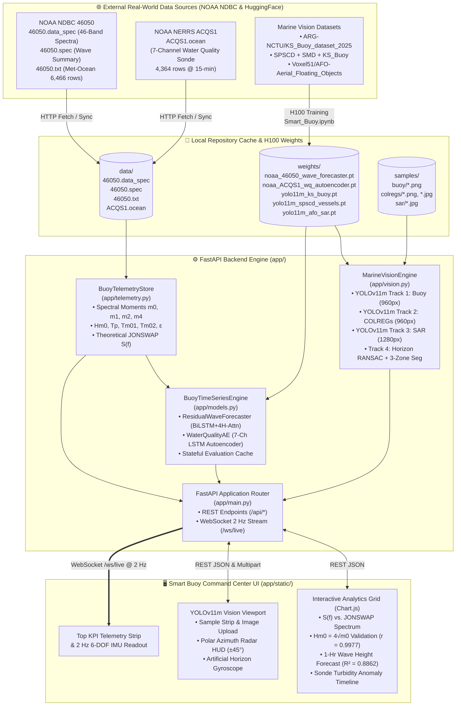
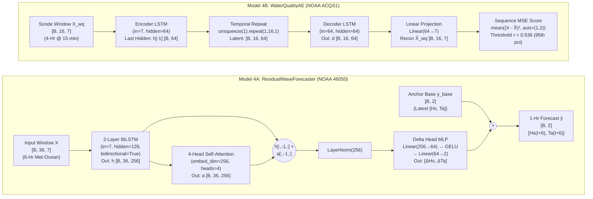
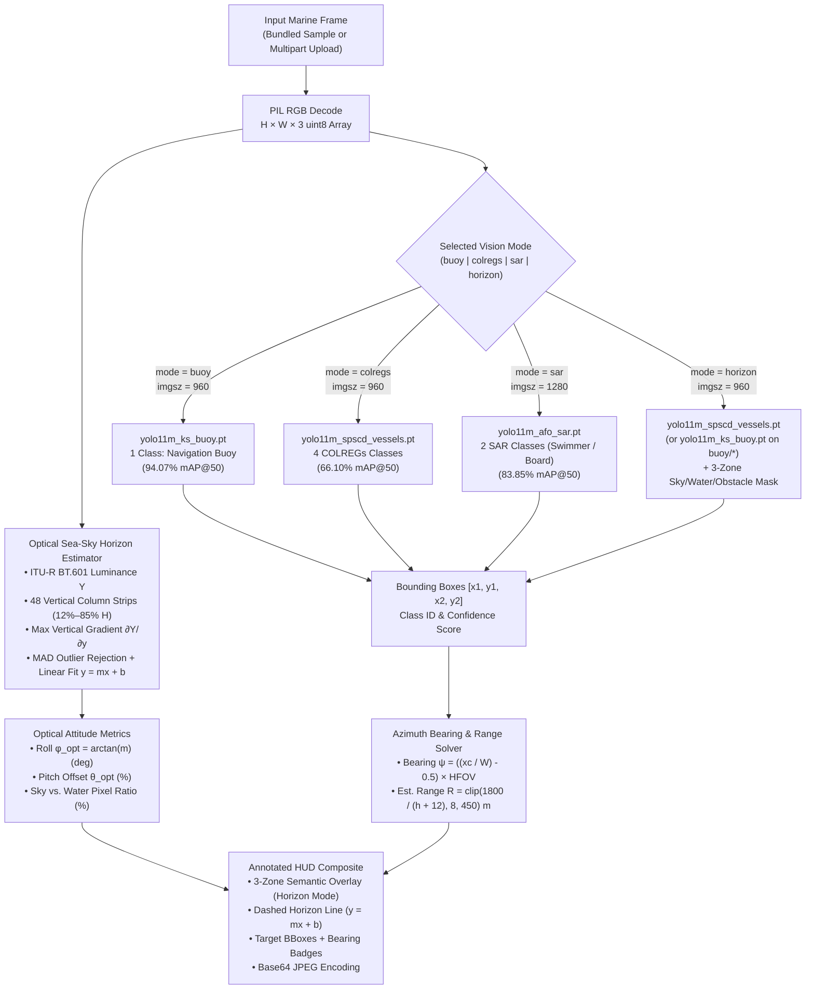

# 🌊 Smart Buoy AI Platform — System Architecture & Scientific Reference

This document provides the complete architectural, mathematical, and deep learning specification for the **Smart Buoy Command & Control AI Platform**. The system unifies real-time oceanographic wave physics from **NOAA NDBC Station 46050**, estuarine multi-parameter water quality sonde telemetry from **NOAA NERRS Station ACQS1**, **PyTorch (`bfloat16`) time-series neural networks**, and a **4-track Ultralytics YOLOv11m Marine Computer Vision engine** trained on an **NVIDIA H100 80GB HBM3 GPU**.

---

## 1. High-Level System Architecture

The platform is architected as a modular, low-latency full-stack system comprising four core operational layers:

1. **Data Ingestion & Spectral Physics Layer (`app/telemetry.py`)** — Fetches, caches, and parses live and historical telemetry from NOAA National Data Buoy Center (`realtime2` feeds) and executes vectorized trapezoidal integration across 46 non-directional frequency bands ($0.033\text{ Hz}$ to $0.485\text{ Hz}$).
2. **Deep Learning Time-Series Engine (`app/models.py`)** — Runs stateful PyTorch inference using pre-trained NVIDIA H100 weights for 1-hour-ahead sea-state forecasting (`ResidualWaveForecaster`) and unsupervised 7-channel estuarine anomaly detection (`WaterQualityAE`).
3. **Multi-Task Marine Computer Vision Engine (`app/vision.py`)** — Manages lazy-loaded **YOLOv11m** (`~20M` parameters) object detectors across 4 maritime surveillance modes alongside a deterministic optical sea-sky horizon estimator and polar radar bearing calculator.
4. **FastAPI Backend & Real-Time Command Center (`app/main.py`, `app/static/`)** — Exposes RESTful JSON endpoints, multipart image upload pipelines, a 2 Hz 6-DOF IMU WebSocket telemetry broadcaster (`/ws/live`), and an interactive zero-build HTML5/Chart.js/Canvas dashboard.

### 1.1 End-to-End Architecture Diagram

### 1.2 Repository Module Breakdown

| Component Path | Responsibility | Key Classes / Functions |
| :--- | :--- | :--- |
| [`app/main.py`](../app/main.py) | FastAPI application setup, CORS middleware, static mounts (`/static`, `/samples`, `/assets`), REST API routes, and `/ws/live` 2 Hz WebSocket server. | `app`, `SampleDetectRequest`, `get_status()`, `get_wave_spectra()`, `get_telemetry()`, `refresh_live_noaa()`, `get_forecast()`, `get_vision_samples()`, `detect_on_sample()`, `detect_on_upload()`, `websocket_live_buoy()` |
| [`app/telemetry.py`](../app/telemetry.py) | Real-world NOAA NDBC (`46050`) and NERRS (`ACQS1`) data ingestion, linear missing-value interpolation, spectral moment integration, and JONSWAP parameterization. | `BuoyTelemetryStore`, `ensure_data_file()`, `jonswap_spectrum()`, `get_wave_spectra_payload()`, `get_telemetry_payload()` |
| [`app/spectral_physics.py`](../app/spectral_physics.py) | WMO Code 3700 Sea State & Beaufort wind classification, deep-water wave steepness $S_p$, Goda's peakedness $Q_p$, Benjamin-Feir Index ($\text{BFI}$), Tayfun nonlinear rogue wave risk, and Pierson-Moskowitz vs. JONSWAP $\gamma$-optimization. | `classify_wmo_sea_state()`, `classify_beaufort_wind()`, `compute_wave_steepness()`, `compute_goda_peakedness()`, `compute_rogue_wave_risk()`, `compare_pm_vs_jonswap()` |
| [`app/models.py`](../app/models.py) | PyTorch neural network architectures, checkpoint loading (`weights_only=True`), sliding-window tensor construction, and cached validation/live inference. | `ResidualWaveForecaster`, `WaterQualityAE`, `BuoyTimeSeriesEngine` |
| [`app/vision.py`](../app/vision.py) | Lazy-loaded Ultralytics YOLOv11m inference across 4 operational modes, robust column-gradient sea-sky horizon line fitting, 3-zone semantic mask blending, and azimuth/range estimation. | `MarineVisionEngine`, `MODEL_SPECS`, `estimate_horizon()`, `run_detection()`, `list_samples()` |
| [`app/colregs_risk.py`](../app/colregs_risk.py) | COLREGs (Rules 5, 6, 12, 14, 15, 16, 17, 18) collision risk scoring, watch-sector classification, CPA/TCPA kinematics, and SOLAS/IAMSAR Search-and-Rescue priority evaluation. | `COLREGsRiskEvaluator`, `evaluate_target_risk()`, `evaluate_frame_risk()`, `classify_bearing_sector()` |
| [`app/simulator.py`](../app/simulator.py) | Edge Smart Buoy 6-DOF Airy orbital wave motion synthesizer, watch-circle GPS drift model, and NMEA-0183 (`$GPZDA`, `$WIMWV`, `$YXMTW`) XOR-checksummed telemetry generator. | `SmartBuoySimulator`, `sample_imu_6dof()`, `sample_gps()`, `generate_nmea_sentences()`, `verify_nmea_sentence()` |
| [`app/static/`](../app/static/) | Responsive dark-themed maritime command center UI (`index.html`, `styles.css`, `app.js`) with Chart.js plots and custom HTML5 2D Canvas HUD widgets. | `initControls()`, `loadWaveSpectra()`, `loadTelemetryAndForecast()`, `drawRadarHUD()`, `drawHorizonGyro()`, `connectLiveWebSocket()` |
| [`Smart_Buoy.ipynb`](../Smart_Buoy.ipynb) | Reproducible 8-module Jupyter/Colab notebook executed on an NVIDIA H100 80GB GPU that trains all PyTorch and YOLOv11m weights and generates benchmark visualizations. | Generated deterministically by [`build_notebook.py`](../build_notebook.py) |

---

## 2. NOAA 46050 Spectral Wave Physics & Sea-State Reconstruction

Offshore wave mechanics are governed by the non-directional wave energy density spectrum $S(f)$ ($\text{m}^2/\text{Hz}$) measured by **NOAA NDBC Station 46050** (*Stonewall Bank, 20 NM West of Newport, Oregon*, $44.669^\circ\text{ N}, 124.534^\circ\text{ W}$).

### 2.1 Spectral Data Structure (`46050.data_spec`)

Each spectral burst record in `data/46050.data_spec` contains $K = 46$ discrete frequency bands spanning long-period ocean swell to short-period wind chop:

$$
f_k \in [0.033\text{ Hz},\; 0.485\text{ Hz}], \quad k = 1, 2, \dots, 46
$$

corresponding to wave periods from $T_{\max} = 30.3\text{ s}$ down to $T_{\min} = 2.06\text{ s}$. Across the 45-day rolling window ($N = 2,145$ bursts at 30-minute intervals), `BuoyTelemetryStore._load_wave_spectra()` constructs the chronological spectral density matrix $\mathbf{S} \in \mathbb{R}^{2145 \times 46}$.

### 2.2 Spectral Moments ($m_n$)

The $n$-th order spectral moment $m_n$ of the sea surface elevation variance spectrum $S(f)$ is defined continuously and evaluated numerically via composite trapezoidal integration (`np.trapezoid`):

$$
m_n = \int_{f_{\min}}^{f_{\max}} f^n \, S(f) \, df \approx \sum_{k=1}^{K-1} \frac{f_k^n S(f_k) + f_{k+1}^n S(f_{k+1})}{2} \, (f_{k+1} - f_k)
$$

Specifically, the engine computes four fundamental moments for every spectral burst:
- **Zero-order moment ($m_0$, $\text{m}^2$):** Total variance $\sigma_\eta^2$ of the sea-surface elevation $\eta(t)$, proportional to total wave energy per unit surface area ($E = \rho g m_0$).
- **First-order moment ($m_1$, $\text{m}^2\cdot\text{Hz}$):** Energy-weighted mean frequency integral.
- **Second-order moment ($m_2$, $\text{m}^2\cdot\text{Hz}^2$):** Variance of vertical sea-surface velocity divided by $(2\pi)^2$.
- **Fourth-order moment ($m_4$, $\text{m}^2\cdot\text{Hz}^4$):** Variance of vertical sea-surface acceleration divided by $(2\pi)^4$.

### 2.3 Sea-State Bulk Parameters

From the integrated moments $(m_0, m_1, m_2, m_4)$, five canonical sea-state parameters are derived:

1. **Zero-Moment Significant Wave Height ($H_{m0}$):**
   $$
   H_{m0} = 4\sqrt{\max(m_0, \, 10^{-8})} \quad [\text{m}]
   $$
   Under a Rayleigh wave height distribution in deep water, $H_{m0}$ closely approximates $H_{1/3}$ (the mean height of the highest one-third of waves). Comparing our integrated $H_{m0}$ against the onboard NDBC payload processor's reported `WVHT` across all $2,145$ bursts yields a Pearson correlation coefficient of **$r = 0.9977$**.

2. **Peak Wave Period ($T_p$):**
   $$
   f_p = \underset{f_k}{\arg\max} \; S(f_k), \qquad T_p = \frac{1}{f_p} \quad [\text{s}]
   $$

3. **Mean Energy Wave Period ($T_{m01}$):**
   $$
   T_{m01} = \frac{m_0}{\max(m_1, \, 10^{-8})} \quad [\text{s}]
   $$

4. **Mean Zero-Upcrossing Period ($T_{m02}$, Rice's Formula):**
   $$
   T_{m02} = \sqrt{\frac{m_0}{\max(m_2, \, 10^{-8})}} \quad [\text{s}]
   $$

5. **Cartwright & Longuet-Higgins Spectral Bandwidth Parameter ($\epsilon$):**
   $$
   \epsilon = \sqrt{\text{clip}\!\left(1 - \frac{m_2^2}{\max(m_0 \, m_4, \, 10^{-12})}, \; 0.0, \; 1.0\right)} \quad \in [0, 1]
   $$
   where $\epsilon \to 0$ indicates a narrow-banded swell-dominated sea state and $\epsilon \to 1$ indicates a broad-banded, multi-modal wind-wave spectrum.

### 2.4 Theoretical JONSWAP Spectrum Formulation

To benchmark empirical storm spectra against analytical fetch-limited wave growth theory, `BuoyTelemetryStore.jonswap_spectrum()` computes the **Joint North Sea Wave Project (JONSWAP)** spectrum parameterized directly by the measured $(H_{m0}, T_p)$ pair:

1. **Pierson-Moskowitz Fully Developed Base Spectrum ($S_{\text{PM}}(f)$):**
   $$
   S_{\text{PM}}(f) = \frac{5}{16} \, H_{m0}^2 \, f_p^4 \, f^{-5} \exp\!\left(-\frac{5}{4}\left(\frac{f}{f_p}\right)^{-4}\right)
   $$

2. **Peak Enhancement Envelope ($\gamma^{r(f)}$):**
   $$
   r(f) = \exp\!\left(-\frac{(f - f_p)^2}{2 \, \sigma(f)^2 \, f_p^2}\right), \qquad
   \sigma(f) = \begin{cases}
   0.07 & \text{if } f \le f_p \\
   0.09 & \text{if } f > f_p
   \end{cases}
   $$

3. **Normalized JONSWAP Energy Density ($S_{\text{JONSWAP}}(f)$):**
   $$
   S_{\text{JONSWAP}}(f) = C(\gamma) \, S_{\text{PM}}(f) \, \gamma^{r(f)}, \qquad C(\gamma) = 1 - 0.287 \ln(\gamma)
   $$
   where $\gamma = 3.3$ is the standard North Sea peak enhancement factor and $C(3.3) \approx 0.6574$ preserves energy conservation $\int S_{\text{JONSWAP}}(f)\,df \approx m_0$.

### 2.5 Real-Time 6-DOF Buoy IMU Wave Superposition (`/ws/live` & `app/simulator.py`)

The `/ws/live` WebSocket endpoint and `SmartBuoySimulator` ([`app/simulator.py`](../app/simulator.py)) reconstruct continuous 2 Hz buoy hull kinematics in the time domain by superposing all 46 measured spectral components from the NDBC burst:

$$
A_k = \sqrt{2 \, \max(S(f_k), 0) \, \Delta f_k}, \qquad \omega_k = 2\pi f_k, \qquad k_k = \frac{\omega_k^2}{g}
$$

$$
\text{Heave } \eta(t) = \sum_{k=1}^{46} A_k \cos(\omega_k t + \phi_k) \quad [\text{m}]
$$

$$
\text{Roll } \phi_{\text{imu}}(t) = 6.5 \sin(2\pi \cdot 0.14 t) + 2.1 \cos(2\pi \cdot 0.23 t) \quad [^\circ]
$$

$$
\text{Pitch } \theta_{\text{imu}}(t) = 4.8 \cos(2\pi \cdot 0.12 t) + 1.7 \sin(2\pi \cdot 0.19 t) \quad [^\circ]
$$

In `SmartBuoySimulator`, full 6-DOF linear Airy orbital kinematics also resolve horizontal surge/sway displacements, 3-axis accelerations ($a_z = g - \sum A_k \omega_k^2 \cos(\omega_k t + \phi_k)$), wave-slope angular rates ($\text{deg/s}$), watch-circle GPS mooring excursion around $44.6690^\circ\text{ N}, 124.5460^\circ\text{ W}$, and XOR-checksummed NMEA-0183 sentences (`$GPZDA`, `$WIMWV`, `$YXMTW`).

### 2.6 Deep-Water Wave Steepness, Benjamin-Feir Index & Rogue Wave Kinematics (`app/spectral_physics.py`)

[`app/spectral_physics.py`](../app/spectral_physics.py) extends the spectral analysis with nonlinear wave mechanics:

1. **Deep-Water Dispersion & Wave Steepness ($S_p, S_{m02}$):**
   $$
   \lambda_p = \frac{g T_p^2}{2\pi}, \qquad k_p = \frac{2\pi}{\lambda_p}, \qquad c_p = \frac{g T_p}{2\pi}, \qquad c_g = \frac{1}{2} c_p
   $$
   $$
   S_p = \frac{2\pi H_{m0}}{g T_p^2}, \qquad S_{m02} = \frac{2\pi H_{m0}}{g T_{m02}^2}
   $$
   Proximity to the Stokes/Miche deep-water wave-breaking limit is evaluated against $S_{\max} = \frac{1}{7} \approx 0.14286$.

2. **Goda's Spectral Peakedness ($Q_p$) & Benjamin-Feir Index ($\text{BFI}$):**
   $$
   Q_p = \frac{2}{m_0^2} \int_{f_{\min}}^{f_{\max}} f \, S(f)^2 \, df, \qquad
   \text{BFI} = \pi\sqrt{\pi} \, S_p \, Q_p, \qquad
   \kappa_{\text{excess}} = \frac{\pi}{\sqrt{3}} \, \text{BFI}^2
   $$

3. **Tayfun Second-Order Nonlinear Maximum Crest & Mori-Janssen Rogue Wave Probability:**
   Over a 3-hour sea state ($D = 10,800\text{ s}$, $N_z = D / T_{m02}$ zero-upcrossings):
   $$
   \mathbb{E}[H_{\max}] = H_{m0} \left(\sqrt{\frac{1}{2}\ln N_z} + \frac{\gamma_E}{2\sqrt{2\ln N_z}}\right) \big(1 + 0.04 \min(\kappa_{\text{excess}}, 2.5)\big)
   $$
   $$
   \mathbb{E}[\eta_{c,\max}] = \frac{1}{2} \mathbb{E}[H_{\max}] \left(1 + \frac{1}{2} k_p \mathbb{E}[H_{\max}]\right), \qquad
   P_{\text{rogue}}(H > 2 H_{m0}) = 1 - \exp\!\Big(-N_z e^{-8}\big(1 + 8\min(\kappa_{\text{excess}}, 3.0)\big)\Big)
   $$

---

## 3. PyTorch Time-Series Deep Learning Architectures

Both deep learning models in [`app/models.py`](../app/models.py) were trained on an **NVIDIA H100 80GB HBM3 GPU** using `torch.amp.autocast('cuda', dtype=torch.bfloat16)` and saved as portable state dictionaries in `weights/`.

### 3.1 Model 4A: `ResidualWaveForecaster` (BiLSTM + 4-Head Self-Attention)

#### Input Feature Vector (`MET_COLS`, $D_{\text{in}} = 7$)
Extracted from `data/46050.txt` ($6,466$ observations at 10-minute intervals, linearly interpolated across sensor dropouts):
1. `WDIR_deg` — Wind direction ($^\circ\text{T}$)
2. `WSPD_mps` — Sustained wind speed ($\text{m/s}$)
3. `GST_mps` — Peak 5–8 second wind gust speed ($\text{m/s}$)
4. `WVHT_m` — Significant wave height $H_s$ ($\text{m}$, column index `3`)
5. `DPD_s` — Dominant wave period $T_p$ ($\text{s}$)
6. `APD_s` — Average wave period $T_a$ ($\text{s}$, column index `5`)
7. `PRES_hpa` — Sea-level barometric pressure ($\text{hPa}$)

#### Windowing & Normalization
- **Chronological Split:** First $80\%$ of records form the training partition; final $20\%$ form the out-of-sample validation partition.
- **Z-Score Standardization:** Computed strictly on the training split ($\mu_{\text{train}}, \sigma_{\text{train}} + 10^{-6}$) to prevent data leakage:
  $$
  \tilde{\mathbf{x}}_t = \frac{\mathbf{x}_t - \mu_{\text{train}}}{\sigma_{\text{train}} + 10^{-6}}
  $$
- **Lookback & Horizon:** Lookback window $L = 36$ steps ($6.0\text{ hours}$) predicting horizon $H = 6$ steps ($+60\text{ minutes}$ ahead).

#### Mathematical Formulation
Given an input sequence $\tilde{\mathbf{X}} \in \mathbb{R}^{B \times 36 \times 7}$ and unnormalized anchor state $\mathbf{y}_{\text{base}} = [H_{s, t-1}, \, T_{a, t-1}] \in \mathbb{R}^{B \times 2}$:

$$
\mathbf{H} = \text{BiLSTM}_{2\text{-layer}}(\tilde{\mathbf{X}}) \in \mathbb{R}^{B \times 36 \times 256}
$$

$$
\mathbf{A} = \text{MultiHeadAttention}_{4\text{-head}}(\mathbf{Q}=\mathbf{H}, \, \mathbf{K}=\mathbf{H}, \, \mathbf{V}=\mathbf{H}) \in \mathbb{R}^{B \times 36 \times 256}
$$

$$
\mathbf{z} = \text{LayerNorm}\big(\mathbf{H}_{:, -1, :} + \mathbf{A}_{:, -1, :}\big) \in \mathbb{R}^{B \times 256}
$$

$$
\Delta \hat{\mathbf{y}} = \mathbf{W}_2 \, \text{GELU}(\mathbf{W}_1 \mathbf{z} + \mathbf{b}_1) + \mathbf{b}_2 \in \mathbb{R}^{B \times 2}
$$

$$
\hat{\mathbf{y}}_{t+H} = \mathbf{y}_{\text{base}} + \Delta \hat{\mathbf{y}}
$$

Why residual forecasting? Ocean wave height and period exhibit strong autocorrelation over 1-hour horizons. Anchoring the output on $\mathbf{y}_{\text{base}}$ allows the BiLSTM+Attention network to dedicate its capacity exclusively to learning wind-driven wave growth and decay gradients $(\Delta H_s, \Delta T_a)$.

#### Training Hyperparameters & Validation Benchmark
- **Optimizer:** `AdamW(lr=1.5e-3, weight_decay=1e-4)` with `CosineAnnealingLR(T_max=25)`
- **Loss Function:** `nn.SmoothL1Loss()` (Huber loss) with `bfloat16` mixed precision
- **Validation Performance (NOAA 46050):**
  - Significant Wave Height ($H_s$): **$\text{MAE} = 0.127\text{ m}$**, **$R^2 = 0.8862$**
  - Average Wave Period ($T_a$): **$\text{MAE} = 0.294\text{ s}$**, **$R^2 = 0.7667$**

---

### 3.2 Model 4B: `WaterQualityAE` (7-Channel Deep LSTM Autoencoder)

#### Input Feature Vector (`WQ_COLS`, $C = 7$)
Extracted from **NOAA NERRS Station ACQS1** (`data/ACQS1.ocean`, $4,364$ records at 15-minute intervals):
1. `OTMP_c` — Estuarine water temperature ($^\circ\text{C}$)
2. `COND_mscm` — Specific conductivity ($\text{mS/cm}$)
3. `SAL_psu` — Practical salinity ($\text{PSU}$)
4. `O2_pct` — Dissolved oxygen saturation ($\%$)
5. `O2_ppm` — Dissolved oxygen concentration ($\text{mg/L}$)
6. `TURB_ntu` — Nephelometric turbidity ($\text{NTU}$, column index `5`)
7. `PH` — Hydrogen ion activity ($\text{pH}$)

#### Baseline Regime Normalization & Sequence Reconstruction
To learn the manifold of normal semi-diurnal tidal mixing without contamination from extreme storm-runoff plumes:
1. Feature mean $\mu_{\text{norm}}$ and standard deviation $\sigma_{\text{norm}}$ are computed over observations below the $85\text{th}$ percentile of turbidity (`raw_wq[:, 5] < np.percentile(raw_wq[:, 5], 85)`).
2. Sliding windows of length $W = 16$ steps ($4.0\text{ hours}$) are constructed: $\mathbf{X}_w \in \mathbb{R}^{N_w \times 16 \times 7}$.
3. During H100 training (20 epochs, `AdamW(lr=3e-3)`), only windows whose maximum turbidity lies below the $80\text{th}$ percentile are used to fit the autoencoder.
4. Forward pass architecture:
   $$
   \_, (\mathbf{h}_T, \mathbf{c}_T) = \text{LSTM}_{\text{enc}}(\mathbf{X}_w), \qquad \mathbf{h}_{[-1]} \in \mathbb{R}^{B \times 64}
   $$
   $$
   \mathbf{Z}_{\text{rep}} = \text{repeat}(\mathbf{h}_{[-1]}, \, W=16) \in \mathbb{R}^{B \times 16 \times 64}
   $$
   $$
   \mathbf{D}, \_ = \text{LSTM}_{\text{dec}}(\mathbf{Z}_{\text{rep}}) \in \mathbb{R}^{B \times 16 \times 64}, \qquad \hat{\mathbf{X}}_w = \mathbf{D}\mathbf{W}_{\text{out}} + \mathbf{b}_{\text{out}} \in \mathbb{R}^{B \times 16 \times 7}
   $$
5. **Anomaly Scoring:** For each window $i$, the mean squared reconstruction error is evaluated across all $16 \times 7 = 112$ sensor-time elements:
   $$
   \mathcal{E}_i = \frac{1}{16 \times 7} \sum_{t=1}^{16} \sum_{c=1}^{7} \left(X_{w, i, t, c} - \hat{X}_{w, i, t, c}\right)^2
   $$
   Windows exceeding the $95\text{th}$ percentile threshold ($\tau_{\text{MSE}} \approx 0.536$) are flagged as anomalous estuarine events ($218$ real sediment plumes and hypoxic dips identified).

#### Stateful Inference Caching
`BuoyTimeSeriesEngine.evaluate_and_forecast()` caches the evaluated dictionary keyed by `(len(df_met), len(df_wq), last_met_timestamp, last_wq_timestamp)`. Repeated calls to `GET /api/forecast` return in $<1\text{ ms}$ unless `POST /api/telemetry/refresh` updates the underlying dataframe store.

---

## 4. YOLOv11m 4-Track Marine Computer Vision Pipeline

The [`MarineVisionEngine`](../app/vision.py) (`app/vision.py`) integrates three specialized **Ultralytics YOLOv11m** (`~20.1M` parameters, `C3k2` cross-stage partial blocks with `C2PSA` spatial attention) checkpoints fine-tuned on an **NVIDIA H100 80GB GPU**, plus a deterministic optical horizon and radar range/bearing pipeline.

### 4.1 Marine Vision Pipeline Dataflow

### 4.2 Summary of the 4 Operational Vision Tracks

| Track Key | Model Checkpoint | Training Dataset | Input Size | Target Classes | Precision | Recall | mAP@50 | mAP@50-95 |
| :--- | :--- | :--- | :---: | :--- | :---: | :---: | :---: | :---: |
| **`buoy`** (Type 1) | `weights/yolo11m_ks_buoy.pt` | `ARG-NCTU/KS_Buoy_dataset_2025` (1,033 sea-level frames) | `960px` | `0: Navigation Buoy` | **97.51%** | **89.90%** | **94.07%** | **64.10%** |
| **`colregs`** (Type 2) | `weights/yolo11m_spscd_vessels.pt` | `SPSCD + Singapore Maritime Dataset (SMD) + KS_Buoy` | `960px` | `0: Commercial Ship / Ferry` `1: Motor / Fishing Craft` `2: Sailing Vessel / Yacht` `3: Navigation Buoy` | **75.60%** *(82.5% peak)* | **60.40%** | **66.10%** | **41.60%** |
| **`sar`** (Type 3) | `weights/yolo11m_afo_sar.pt` | `Voxel51/AFO-Aerial_Floating_Objects` (1,288 val instances) | `1280px` | `0: Human / Swimmer in Water` `1: Windsurf / SUP / Rescue Board` | **83.18%** | **77.87%** | **83.85%** | **37.93%** |
| **`horizon`** (Type 4) | `yolo11m_spscd_vessels.pt` *(auto-switches to `yolo11m_ks_buoy.pt` on `buoy/*` samples)* | Sea-Surface & Coastal Vessel Traffic Frames | `960px` | `Sky Zone`, `Navigable Open Water`, `Surface Obstacle` | **94.07%** | **89.90%** | **94.07%** | **64.10%** |

### 4.3 Optical Sea-Sky Horizon Attitude Estimation (`MarineVisionEngine.estimate_horizon`)

Given an RGB frame $\mathbf{I} \in [0, 255]^{H \times W \times 3}$, the optical attitude solver extracts the sea-sky horizon line without requiring an inertial measurement unit:

1. **ITU-R BT.601 Luminance Conversion:**
   $$
   Y(y, x) = 0.299 \, R(y, x) + 0.587 \, G(y, x) + 0.114 \, B(y, x)
   $$

2. **Vertical Column Gradient Sampling:**
   To avoid vignette artifacts and hull/mast obstructions at the top and bottom edges, vertical search is restricted to $y \in [y_{\min}, y_{\max}] = [\lfloor 0.12 H \rfloor, \lfloor 0.85 H \rfloor]$. Across $M = 48$ horizontally spaced column centers $x_j \in [\lfloor 0.05 W \rfloor, \lfloor 0.95 W \rfloor]$, a local 8-pixel horizontal strip is averaged vertically and differentiated:
   $$
   \bar{Y}_j(y) = \frac{1}{x_j^+ - x_j^-} \sum_{x=x_j^-}^{x_j^+} Y(y, x), \qquad
   y_j^* = y_{\min} + \underset{y \in [y_{\min}, y_{\max}]}{\arg\max} \left|\frac{\partial \bar{Y}_j(y)}{\partial y}\right|
   $$

3. **MAD-Based Robust Outlier Rejection & Least-Squares Line Fit:**
   Clouds, whitecaps, or vessels intersecting column $x_j$ produce spurious gradient peaks. Let $\tilde{y} = \text{median}(\{y_j^*\}_{j=1}^{48})$ and $\text{MAD} = \text{median}(|y_j^* - \tilde{y}|)$. The inlier set $\mathcal{I}$ is defined by:
   $$
   \mathcal{I} = \Big\{ j \in \{1, \dots, 48\} \;\Big|\; |y_j^* - \tilde{y}| < 2.5 \cdot \text{MAD} + 8.0 \Big\}
   $$
   If $|\mathcal{I}| \ge 6$, ordinary least squares (`np.polyfit`) fits the horizon line $y_{\text{hor}}(x) = m x + b$ over $\{(x_j, y_j^*)\}_{j \in \mathcal{I}}$; otherwise it falls back to $m = 0, b = \tilde{y}$.

4. **Optical Roll ($\phi_{\text{opt}}$) & Pitch Offset ($\theta_{\text{opt}}$):**
   $$
   \phi_{\text{opt}} = \arctan(m) \cdot \frac{180^\circ}{\pi} \quad [^\circ]
   $$
   $$
   y_{\text{mid}} = m \left(\frac{W}{2}\right) + b, \qquad
   \theta_{\text{opt}} = \left(0.5 - \frac{y_{\text{mid}}}{H}\right) \times 100\%
   $$

5. **3-Zone Semantic Segmentation Mask (`mode="horizon"`):**
   - **Sky Zone ($\mathcal{M}_{\text{sky}}$):** Pixels above the horizon ($y < m x + b$) blended with sky-cyan tint `[56, 189, 248]` ($\alpha = 0.22$).
   - **Navigable Open Water ($\mathcal{M}_{\text{water}}$):** Pixels at or below the horizon ($y \ge m x + b$) blended with emerald tint `[16, 185, 129]` ($\alpha = 0.25$).
   - **Surface Obstacle Zone ($\mathcal{M}_{\text{obs}}$):** YOLOv11m bounding box regions $[x_1, y_1, x_2, y_2]$ blended with high-visibility hazard red `[239, 68, 68]` ($\alpha = 0.55$).

### 4.4 Pinhole Camera Azimuth Bearing & Monocular Range Estimation

For every detected maritime target with bounding box $[x_1, y_1, x_2, y_2]$ and pixel center $(x_c, y_c) = \left(\frac{x_1+x_2}{2}, \frac{y_1+y_2}{2}\right)$:

1. **Relative Azimuth Bearing ($\psi$, degrees relative to camera bow):**
   Assuming a rectilinear marine optical sensor with horizontal field of view $\text{HFOV} = 90.0^\circ$:
   $$
   \psi = \left(\frac{x_c}{W} - 0.5\right) \cdot \text{HFOV} \quad \in [-45.0^\circ, \, +45.0^\circ]
   $$
   where negative angles denote **Port** bearings and positive angles denote **Starboard** bearings.

2. **Monocular Range Heuristic ($\hat{R}$, meters):**
   Using the vertical bounding-box extent $h_{\text{box}} = \max(1, y_2 - y_1)$:
   $$
   \hat{R} = \text{clip}\!\left(\frac{1800.0}{h_{\text{box}} + 12.0}, \; 8.0, \; 450.0\right) \quad [\text{m}]
   $$
   These $(\psi, \hat{R})$ coordinates drive the real-time **Polar Azimuth Radar HUD (`#radar-canvas`)** in the Command Center frontend.

### 4.5 COLREGs Collision Risk & IAMSAR/SOLAS SAR Priority Evaluator (`app/colregs_risk.py`)

[`app/colregs_risk.py`](../app/colregs_risk.py) translates each optical detection's $(\text{class}, \psi, \hat{R}, \text{conf})$ tuple into actionable maritime watch intelligence:

1. **Watch Sector Classification (`classify_bearing_sector`):**
   - **Dead Ahead (Bow), $|\psi| \le 6.0^\circ$:** COLREGs Rule 14 Head-On sector ($\text{weight} = 1.00$)
   - **Starboard Bow, $+6.0^\circ < \psi \le +22.5^\circ$:** COLREGs Rule 15/16 Crossing Give-Way sector ($\text{weight} = 0.94$)
   - **Port Bow, $-22.5^\circ \le \psi < -6.0^\circ$:** COLREGs Rule 15/17 Crossing Stand-On sector ($\text{weight} = 0.84$)
   - **Port / Starboard Beam & Quarter, $|\psi| > 22.5^\circ$:** Overtaking / Beam watch sectors

2. **Closest Point of Approach (CPA) & Time to CPA (TCPA) Kinematics:**
   $$
   \text{CPA} \approx 0.65 \, \hat{R} \sin\!\big(\min(85^\circ, |\psi|)\big), \qquad
   \text{TCPA} \approx \frac{\hat{R}}{\max\!\big(0.25, \, v_{\text{close}}(\text{class}) \cos(\min(75^\circ, |\psi|))\big)}
   $$
   with proximity decay $P(\hat{R}) = \exp(-\hat{R}/110.0) + 0.18 \cdot \mathbb{I}(\hat{R} \le 35\text{ m})$.

3. **SOLAS / IAMSAR Search-and-Rescue Priority:**
   - `Human / Swimmer in Water` $\to$ `P1_IMMEDIATE_RESCUE` (*SOLAS Ch. V Reg. 33*, minimum risk floor `75.0 / CRITICAL`).
   - `Windsurf / SUP / Rescue Board` $\to$ `P2_ACTIVE_ASSIST` (*IAMSAR / COLREGs Rule 18*).

